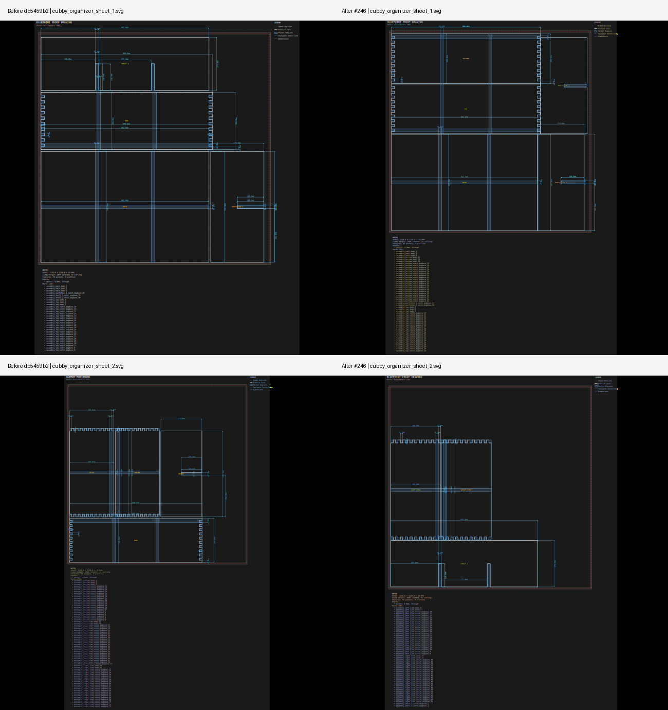
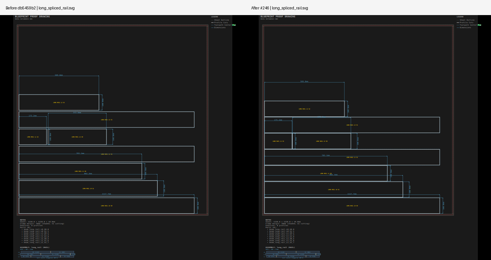
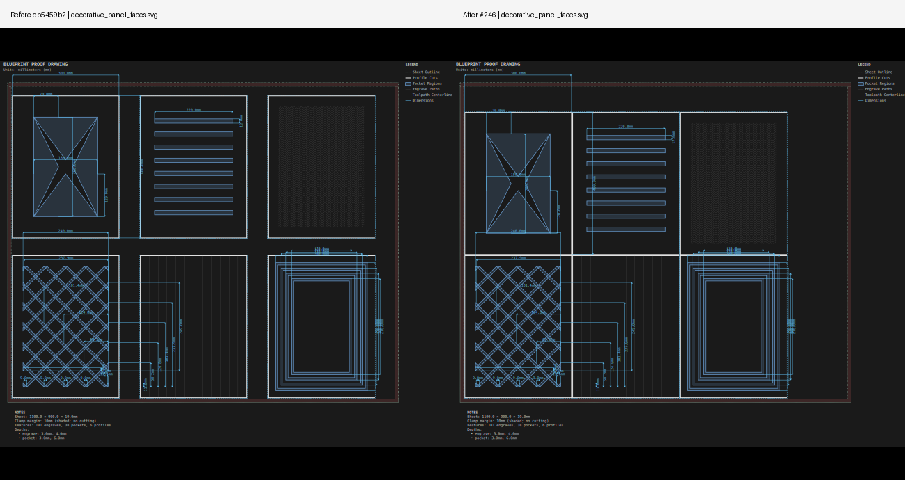

# Issue #246: cutter-aware layouts and polygon common cuts

Baseline: `db5459b2`. This baseline already includes #247 and already fits Cubby
on two sheets. The comparisons below do not reuse the older three-sheet claim.

## Behavior

Assembly and beam sources can request `layout_gap: auto`. Numeric gaps remain
complete nominal separations and the omitted default remains 10mm. Assembly
partitioning passes nominal PanelSpec dimensions and the gap to either packer,
retaining identities and permitting exact edge fits without a trailing gap.

The actual selected profile cutter reaches resolution through MachiningClearance.
Automatic layouts use SheetSpec's kerf-plus-margin contract, then preflight all
sheets before returning them. A measured conservative clearance increase can
trigger up to four deterministic attempts. Both the final gaps and attempt
reasons appear in metrics. Numeric gaps are never changed by this process.

Machining items and RemovalIntent retain semantic part ownership. Planner move
ranges retain contributing feature IDs, including atomic shared seams and
rough/finish/release operations. The same checker is called by automatic-layout
preflight and the normal pipeline. It checks complete cutting segments with the
actual tool radius against neighbors, working-area margins and fixtures. Legacy
single-workpiece sources remain usable; independent parts must identify local
operations. Nesting preserves ownership through AST/JSON and PML lifting. Polygon
lifting also preserves its absolute placement, and lifting retains the full Sheet
specification. Machining-aware nesting requires AST/JSON to preserve its cutter
contract; plain PML remains a geometry export.

Rectangles and polygons use one common-cut implementation. It constructs the
same compensated contours as ordinary profiles, accepts only opposite-facing
coincident straight intervals, and nodes partial overlaps and T intersections.
Atomic intervals retain their contributing feature IDs. Compatible connected
parts use shared seams plus union outlines, including holes; short rejected
intervals retain their original cuts. Planned sweeps must preserve all original
retained polygons. Numerical alignment is limited to 1e-9mm, independently of the
merge enable setting. This is neither polygon interlocking nor curved-path or
arbitrary air-cut elimination.

Per-feature allowance, feeds, ramps, starting-depth differences and depth/tool
incompatibility exclude sharing. Tab/onion jobs keep ordinary profiles and
require disjoint kerfs (at least 2D separation, including allowance). Merely
turning merging off does not protect differently positioned tabs. Existing
rough/finish/release barriers remain in force. A shared slot cannot climb-finish
both opposing retained walls; the optimization makes no such promise. Supported explicit
finishing requirements retain ordinary passes. Unsupported profile direction,
finishing or ramp keys are rejected at the PML boundary rather than ignored.
JSON profiles also reject unknown direction/finishing keys. CNC rounding tolerance is
0.001mm for retained material and 0.002mm for the conservative external tab
stock envelope; this does not enlarge the path-coincidence tolerance.

## Emitted-program evidence

[proof.json](proof.json) records before/after source and NC SHA256 hashes, runtime,
nominal-area utilization, unique shared length, per-seam level and ramp travel,
and material sections. The baseline and current code each resolved their own
sources; the material checks read their canonical emitted NC files.

For the eight automatically laid-out recipes, 106 nominal profiles are unchanged.
318 material sections reconstruct cylindrical cutter sweeps at 1mm, halfway
through stock plus 0.01mm, and 0.01mm above the bottom. Ramps are clipped at each
section height. Per-part retained material is compared in the part's own frame,
including grooves, relief and through profiles. The maximum finished span
difference is 0.001mm. Raw symmetric-difference areas are retained in the report;
acceptance uses perimeter × 0.002mm to account for serialized NC rounding.

Span measurement opens regions by 0.001mm to discard sub-resolution slivers left
by Boolean operations on rounded cutter paths. The report also retains the raw
bound differences, which can be large for microscopic disconnected slivers.
This cleanup does not conceal the raw area comparison. The existing assembly-fit
tests independently retain the box, carcass, Cubby and beam contracts.

152 shared atomic intervals are measured from emitted programs. Level travel
matches one full seam per depth within 0.004mm of rounding/endpoint tolerance;
ramp travel and additional full retraversals are recorded separately. Shared
seams have zero additional full retraversals and zero ramp travel. This verifies duplicate seam
removal through actual cutting motion, rather than reduced feature counts.
Utilization uses actual nominal polygon area divided by declared usable sheet
area. Declared sheets and margins are unchanged, so a more compact footprint
does not imply an increased whole-sheet percentage.

| Recipe | Sheets before → after | Runtime minutes before → after | Unique shared mm |
|---|---:|---:|---:|
| base_cabinet | 2 → 2 | 207.0 → 185.9 | 2902.875 |
| bookcase | 3 → 3 | 225.2 → 194.6 | 3758.700 |
| box_bottoms_and_lids | 1 → 1 | 145.0 → 149.5 | 1638.939 |
| cubby_organizer | 2 → 2 | 418.7 → 442.0 | 3918.394 |
| finger_jointed_box | 1 → 1 | 25.0 → 26.1 | 307.390 |
| long_spliced_rail | 1 → 1 | 155.4 → 123.0 | 4182.525 |
| side_table_frame | 1 → 1 | 230.2 → 195.9 | 4265.400 |
| joinery_test_coupons | 1 → 1 | 124.3 → 123.3 | 1061.875 |

Short disconnected finger seams introduce additional entries and depth cycles.
Cubby, the small box and the bottom/lid comparison therefore take longer under
the canonical runtime estimator despite eliminating duplicate seam travel.
The other five estimates improve. This tradeoff is explicit; there is no new
unrequested cutting strategy to conceal it. Part redistribution also changes
sheet-level pocket/relief counts, entry ordering and clearing tie breaks; the
per-part material comparison verifies their equivalent results. Every changed
canonical output is committed together with the compiler change.

The broader emitted-program audit covers 115 programs and 406,150 cutting
segments across all 33 recipes, with zero cutter-margin or fixture violations.
All generic G-code invariants pass except the existing stepdown heuristic on
three unchanged `production_sheet` programs. Those NC hashes match the baseline:
the checker counts the authorized 25mm safe-Z air travel as cutting stepdown.
The independent stock-surface-clipped penetration measurement has a 19.2mm
maximum, below its generic 26mm limit; release roughing has already removed stock
above the onion skin. The original safe-Z and release policy are preserved.
These baseline checker limitations remain explicit in the report.

## Visual comparisons

The images render the original canonical blueprints; there are no supplemental
SVG files inside recipes. Left is the baseline, right is this implementation.







All changed blueprint files were also reviewed in temporary contact sheets.
The original 10mm clamp margins, back registration, grain/orientation, nominal
parts and part-local machining remain unchanged.

## Complete recipe inventory

| Recipe | Disposition | Reason / change |
|---|---|---|
| base_cabinet | Optimized | Auto gap; nominal multi-sheet packing and shared polygon seams. |
| bookcase | Optimized | Auto gap; three declared sheets remain necessary without rotations. |
| box_bottoms_and_lids | Optimized | Auto gaps inside its four explicit comparison regions. |
| cubby_organizer | Optimized | Auto gap; two sheets independently preflighted; finger and half-lap outlines preserved. |
| finger_jointed_box | Optimized | Auto gap and eligible partial finger-profile seams. |
| long_spliced_rail | Optimized | Auto layer/segment gap; 2000/2076mm assembled spans unchanged. |
| side_table_frame | Optimized | Auto gaps within member regions; mortises, tenons and layer ordering retained. |
| decorated_shaker_door | Already compact | One door, existing perimeter clearance. |
| hinge_cup_door | Already compact | One door; registered back bores and back-before-front setup preserved. |
| multi_panel_doors | Optimized with holding | Move complete door regions to 6.35mm external gaps; preserve narrow-pair sizes and internal spacing. |
| raised_panel_doors | Optimized with holding | Move the complete arch region to a 6.35mm gap; preserve tabs and all local raised-panel geometry. |
| shaker_door | Already compact | One door with tabs; no neighboring part to pack. |
| layout_board | Intentional sheet workflow | Continuous engraved stock, no independent profile blanks. |
| shop_ruler | Already compact | One ruler profile and its own markings. |
| sign | Intentional sheet workflow | One continuous engraved sign blank. |
| svg_artwork | Intentional sheet workflow | Three machining-mode regions on continuous stock; these are not three declared retained panel profiles. |
| cabinet_side | Already compact | One cabinet side with local dados and pin holes. |
| decorative_panel_faces | Optimized | Translate whole panels to 3.175mm row/column gaps; shared straight profiles. |
| edge_treatments | Optimized with machining clearance | Reduce gaps from 45mm to 25.4mm; preserve edge-tool clearance, allowance and independent finish operations. |
| frames_and_trays | Optimized | Compact the rectangular top-row bounding boxes; reserve 6.35mm between curved neighbors. No polygon interlocking. |
| pocket_with_island | Already compact | One profiled panel and its retained island. |
| recessed_mounting_plate | Already compact | One profiled plate, floor and through holes. |
| curve_coasters | Optimized | Translate complete circles to 6.35mm gaps; curved intersections remain separate cuts. |
| pattern_coasters | Optimized | Translate complete circles to 6.35mm gaps, preserving all local patterns. |
| radial_patterns | Optimized | Translate complete circular blanks to 6.35mm gaps. |
| relief_carving | Intentional sheet workflow | One relief region; no neighboring outline profiles. |
| nested_cabinet_job | Holding incompatibility addressed | Explicit `gap_margin: 6.35mm` with the 6.35mm cutter protects tabs/onion stock; still two sheets. Actual cutter selected before packing. |
| production_sheet | Intentional full-sheet workflow | Preserve authored waste-cut kerf, mixed holding, safe Z and per-tool release order. Ownership and sweep checks still apply. |
| calibration_coupon | Optimized | Move the separate 40mm block to a 3.175mm gap; keep the main coupon and its local calibration features fixed. |
| clamp_keepouts | Explicit fixture spacing | Preserve all five clamp zones and the demonstrated safe/unsafe travel corridors. |
| joinery_test_coupons | Optimized | Auto spacing within each anchored comparison region. |
| pocket_corner_test | Intentional sheet workflow | Six pocket strategies on continuous stock; no independent outside profiles. |
| spoilboard_surfacing | Intentional full-sheet workflow | Preserve full-bed facing, authorized overrun, cooling and zero-margin setup. |

## Reproducing the proof

Use a separate detached checkout at `db5459b2` with its unchanged native extension
built or linked from the current checkout. Run this audit script against each
checkout's committed/generated outputs, using the current environment's Python:

```bash
.venv/bin/python docs/evidence/issue_246/audit.py --repo /path/to/baseline --snapshot /tmp/246-before.json
.venv/bin/python docs/evidence/issue_246/audit.py --repo "$PWD" --snapshot /tmp/246-after.json
.venv/bin/python docs/evidence/issue_246/audit.py --before /tmp/246-before.json --after /tmp/246-after.json --report /tmp/246-proof.json
```

The script resolves every recipe and hashes every source and NC file. It rejects
unsupported G2/G3 programs rather than approximating their sweeps as chords.
Its full WKB snapshots remain scratch artifacts; the committed report contains
measurements and hashes. Tests own their PML inputs and never read recipes.

## Validation

3,499 Python tests and the native tests pass. Lint/format, strict mypy and the
touched-source duplication check pass. All 33 canonical recipe checks pass.
Normal mypy and recipe-output hooks are enforced on the implementation commit. No issue is closed or code pushed by this change; the commit carries
`Fixes #246` for the owner's later push.
