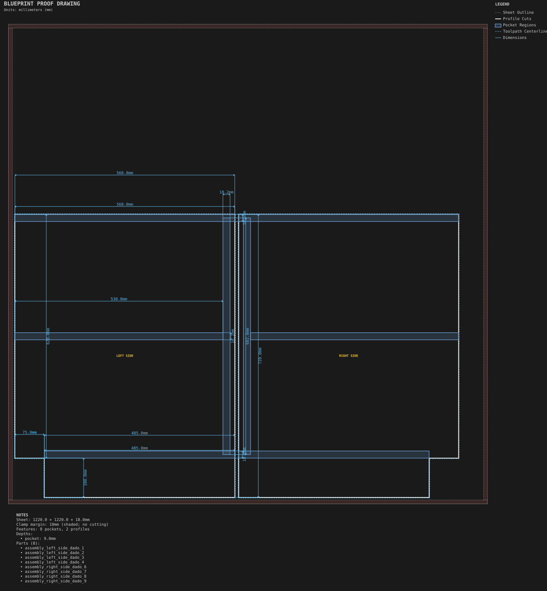
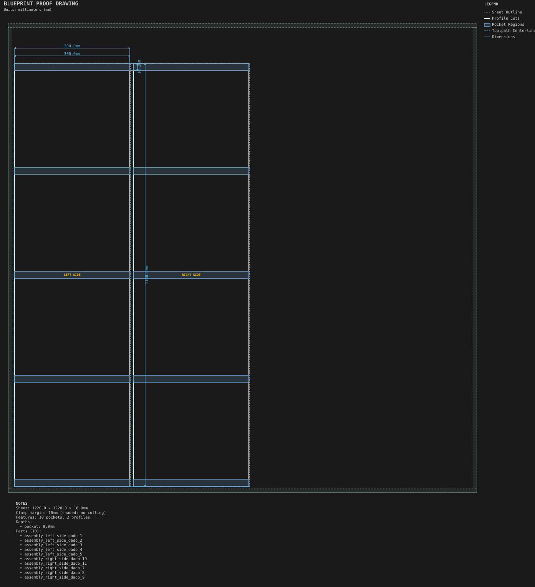
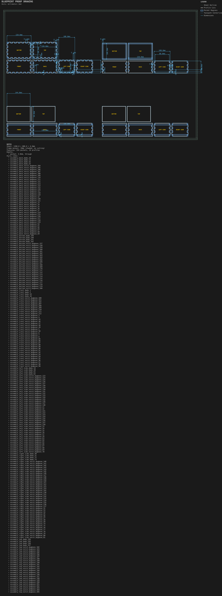
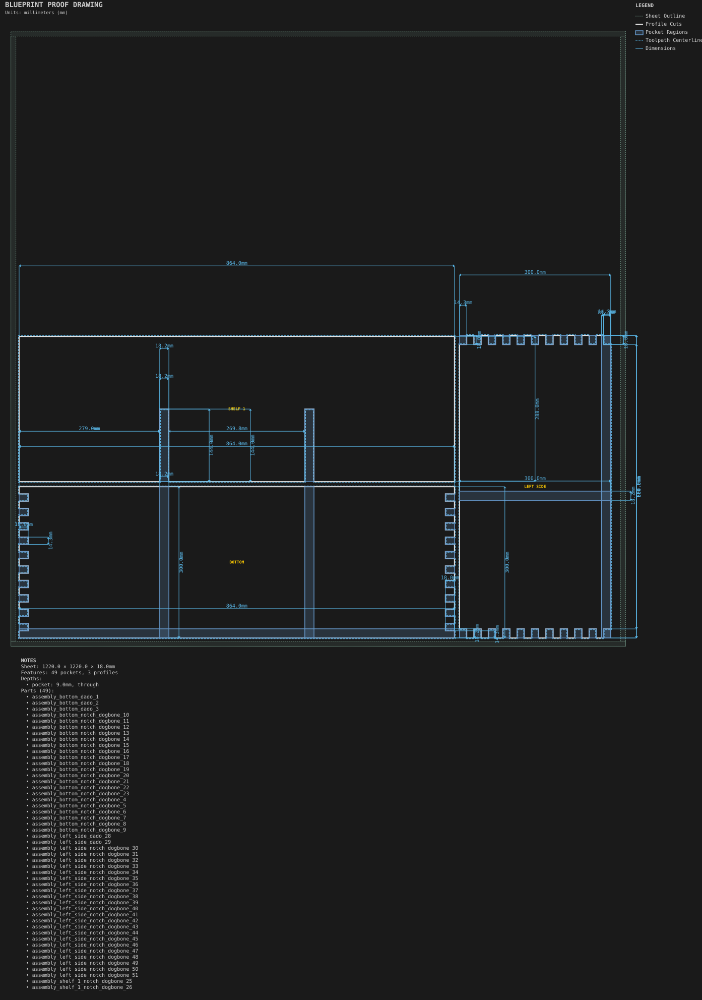
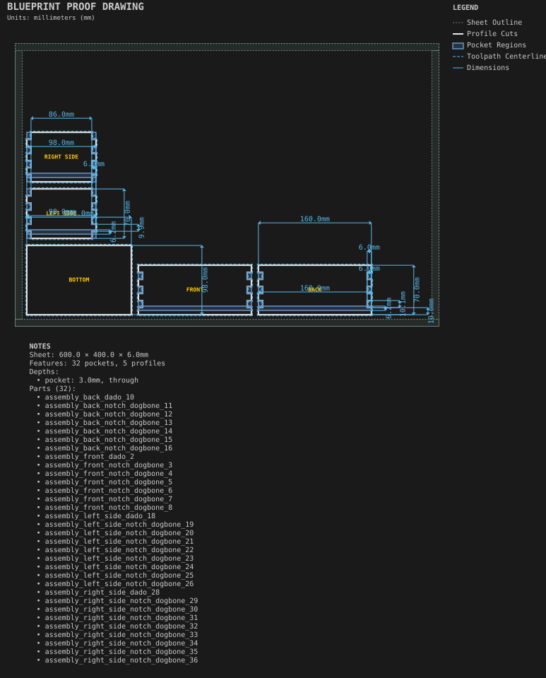

# Assemblies

Multi-panel builds with interface joinery. Large assemblies split across 1220 × 1220 sheets.

Generated by `python -m cli.recipes --regen`. Do not edit by hand.

## [Base cabinet](base_cabinet/)

A carcass assembly split across sheets by multi-sheet partitioning.

## [Bookcase](bookcase/)

Carcass partitions and dadoed shelves.

## [Box bottoms and lids](box_bottoms_and_lids/)

Box top and bottom joinery: captured, dado, finger and plug.

## [Cubby organizer](cubby_organizer/)

A cubby assembly with half-lap dividers, a finger-jointed perimeter and a captured back.

## [Finger-jointed box](finger_jointed_box/)

A box assembly with finger-jointed sides, a captured bottom, labels and edge colours.
