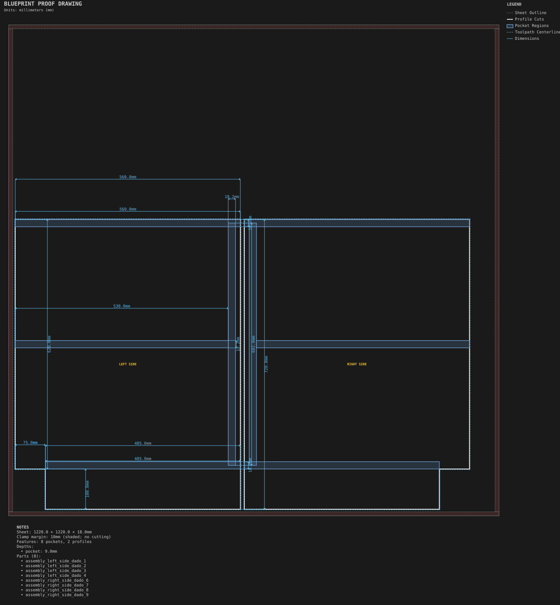
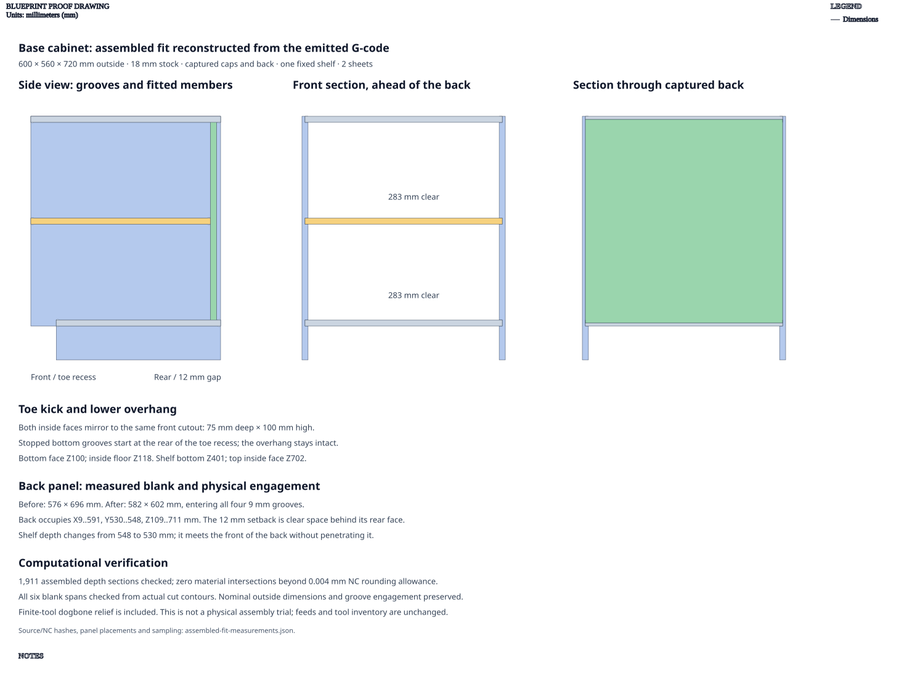
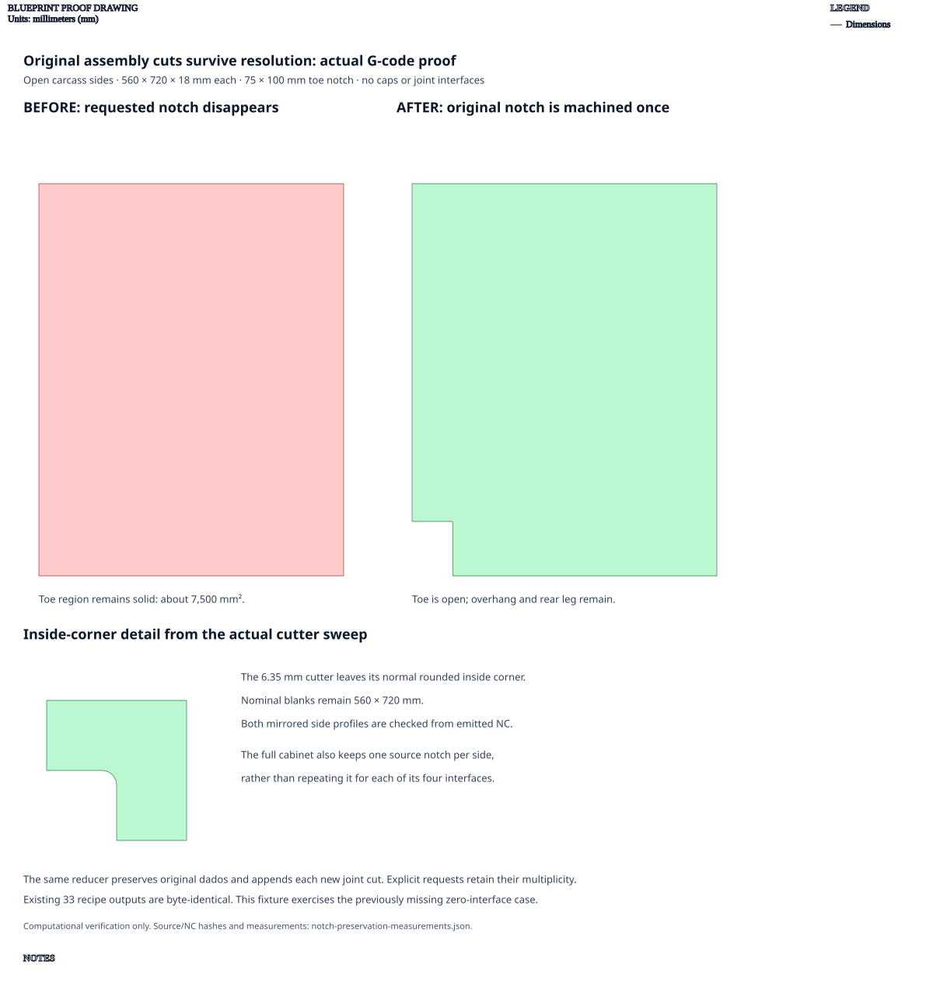
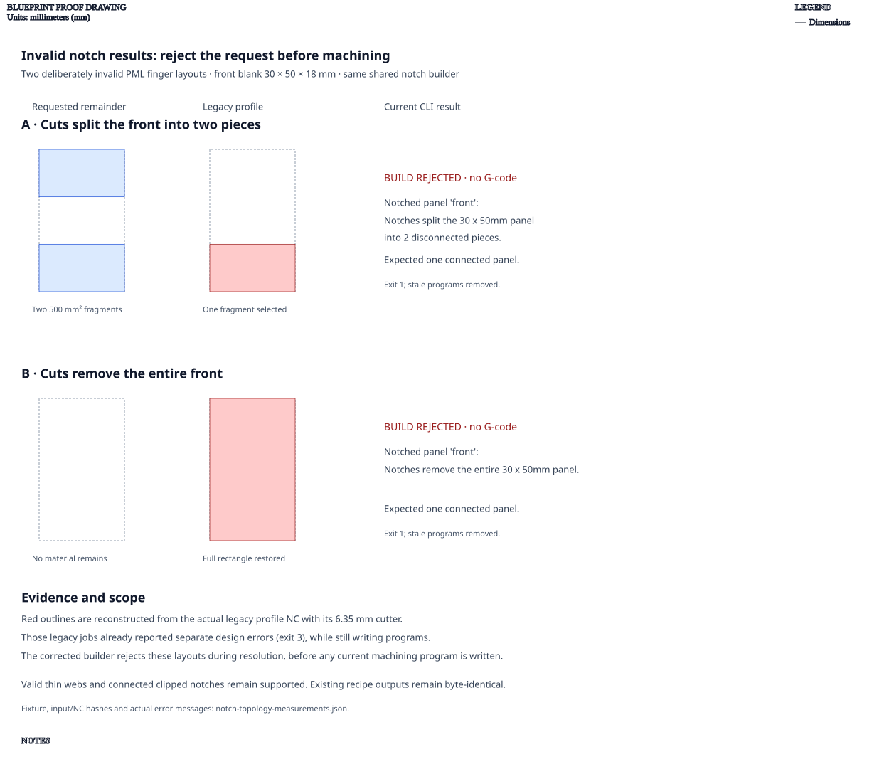

# Base cabinet

**Demonstrates:** A carcass assembly split across sheets by multi-sheet partitioning.

## What gets cut

A 600 × 560 × 720mm frameless cabinet with captured top, bottom and back, one
fixed shelf, and an open toe recess, cut from two 1220 × 1220 × 18mm MDF sheets.

| Member | Quantity | Blank dimensions |
|--------|----------|------------------|
| Sides | 2 | 560 × 720mm, with mirrored 75 × 100mm front toe cutouts |
| Top | 1 | 582 × 560mm |
| Bottom | 1 | 582 × 485mm |
| Back | 1 | 582 × 602mm |
| Fixed shelf | 1 | 582 × 530mm |

Caps, shelf and back engage their specified 9mm grooves. The bottom's lower face
is 100mm above the cabinet bottom; its inside face is at 118mm. The shelf starts
at 401mm and the top's inside face is at 702mm, leaving two 283mm clear openings.
Bottom side grooves start at the rear of the toe recess, preserving the front
overhang. The cutout's internal corner retains the normal cutter radius.

The back occupies depth 530–548mm: `back_inset: 12mm` is clear space behind its
rear face. Its height fits the raised bottom and top, and its width fits the side
grooves. The shelf stops at the back's front face; back shelf support is disabled.
There is no toe-cover panel. Every panel uses the specified 18mm stock.

Machine the inside faces upward. The right-side blank is mirrored; the top's
depth direction is also reversed, placing its rear groove at the correct edge.
Corrected parts pack onto two sheets; the earlier oversized back required three.

## Assembled-fit proof

The proof reconstructs retained panels from the emitted profile, pocket and
dogbone cutter sweeps. It checks all six blank spans and 1,911 assembled depth
sections with no material interference beyond the 0.004mm NC rounding allowance.
That allowance erodes measured profile boundaries and expands groove boundaries
in their machining planes; stock thickness and cut depths remain exact. The
mirrored toe cutouts, intact overhang, back plane and 9mm engagement are checked
explicitly. This is computational verification, not a physical assembly trial.
Source/NC hashes, placements and measurements are in
[assembled-fit-measurements.json](assembled-fit-measurements.json).

The former back measured 576 × 696mm and the shelf extended 18mm into its intended
plane. These defects were not reported by the recipe gate. The proof verifies
the corrected 582 × 602mm back and 530mm-deep shelf. The
[bookcase proof](../bookcase/carcass-shelf-fit-proof.svg) covers the shared cap and
shelf-width rules separately.

Estimated runtime: 206.9 minutes. Tooling, feeds, stock, outside dimensions and
the source recipe are unchanged.

## Notch preservation when interfaces are absent

An [open-side PML fixture](../../../../tests/fixtures/assemblies/notched_open_sides.pml.yml)
keeps the same side/toe dimensions with no top, bottom, back or joint interfaces.
Previously assembly resolution dropped its factory-defined notches and emitted
two rectangular profiles. The corrected reducer retains each original notch
and dado once, then appends new joint cuts. The normal cabinet also keeps one
source toe notch per side, rather than inheriting it four times.

The before/after proof reconstructs both emitted NC programs with their actual
6.35mm cutter. The formerly solid 75 × 100mm region is now open, with about
2.164mm² of normal rounded inside-corner stock left by the tool. Both 560 × 720mm
blank spans and the overhang/rear leg are preserved. Source and NC hashes are in
[notch-preservation-measurements.json](notch-preservation-measurements.json).
This is computational proof. The existing recipe's outputs are byte-identical;
the fixture covers the previously missing interface-free case.

### Invalid notch-result topology

The shared notch builder now rejects subtraction that removes the whole panel
or splits it into disconnected pieces. The old fallbacks restored the original
rectangle or kept only the largest fragment. None of the 33 current recipes
triggered those fallbacks in the audit; this cabinet's outputs remain unchanged.

The deliberately invalid
[PML fixture](../../../../tests/fixtures/assemblies/notch_topology.pml.yml)
uses a 30mm-wide box with 18mm finger joints. Its front splits into two pieces;
an extreme-clearance variant removes it entirely. The comparison reconstructs
the legacy profile program using the actual cutter. Those old jobs already
reported other design errors, but still wrote the fallback profiles. The current
CLI rejects both during resolution, names the member, and writes no NC programs.
Its normal cleanup also removes stale programs.

[Measurements and source/NC hashes](notch-topology-measurements.json) record the
comparison and CLI results. This is computational evidence for rejecting invalid
layouts, not an approved machining example. Valid clipping and thin connected
webs retain their existing geometry.

Sheet 1: 1220 × 1220 × 18mm mdf.

- `sheet_1.pocket-12.70mm.nc`: pocket, 12.7mm tool, 8 feature(s), to 9mm
- `sheet_1.dogbone-12.70mm.nc`: dogbone, 12.7mm tool, 32 feature(s), to 9mm
- `sheet_1.profile-3.17mm.nc`: profile, 3.175mm tool, 2 feature(s), to 18.2mm

Sheet 2: 1220 × 1220 × 18mm mdf.

- `sheet_2.pocket-12.70mm.nc`: pocket, 12.7mm tool, 2 feature(s), to 9mm
- `sheet_2.dogbone-12.70mm.nc`: dogbone, 12.7mm tool, 8 feature(s), to 9mm
- `sheet_2.profile-3.17mm.nc`: profile, 3.175mm tool, 4 feature(s), to 18.2mm

## Run

`python -m cli.mill --recipe docs/recipes/assemblies/base_cabinet`

## Outputs

- `base_cabinet_sheet_1.svg`
- `base_cabinet_sheet_2.svg`
- `machining_summary.json`
- `manifest.json`
- `metrics.json`
- `sheet_1.dogbone-12.70mm.nc`
- `sheet_1.pocket-12.70mm.nc`
- `sheet_1.profile-3.17mm.nc`
- `sheet_2.dogbone-12.70mm.nc`
- `sheet_2.pocket-12.70mm.nc`
- `sheet_2.profile-3.17mm.nc`
