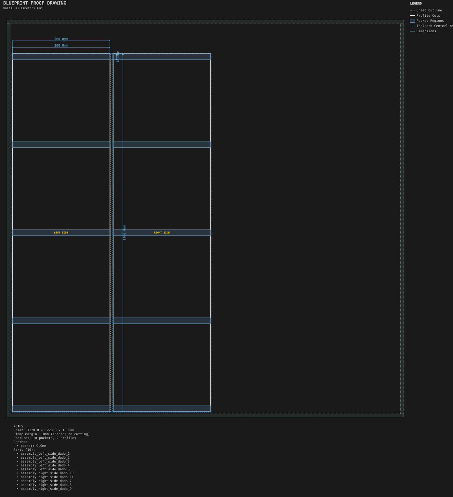
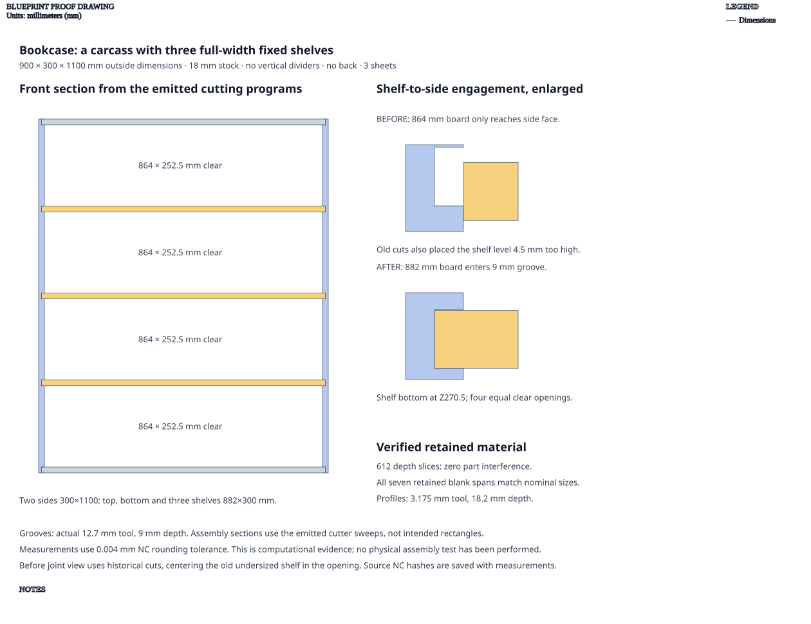

# Bookcase

**Demonstrates:** A carcass with three full-width fixed shelves captured in side dados.

## What gets cut

A 900 × 300 × 1100mm bookcase made with the `carcass` assembly: two sides,
a top, a bottom and three full-width fixed shelves. This recipe has no vertical
dividers and no back. It demonstrates how adding `fixed_shelves` turns a carcass
into a bookcase; `bookcase` is not a separate named assembly type.

| Part | Blank size | Quantity |
|------|------------|----------|
| Sides | 300 × 1100mm | 2 |
| Top / bottom / shelves | 882 × 300mm | 5 |

All parts use 18mm stock. The horizontal boards enter 9mm-deep side grooves,
leaving an inside width of 864mm. Shelf bottoms sit at 270.5, 541 and 811.5mm
from the outside bottom, producing four equal 252.5mm-high clear openings.

The proof reconstructs retained material from actual profile, pocket and relief
cutter sweeps. All seven blank spans match nominal dimensions within 0.004mm
NC rounding tolerance; 612 depth slices show no part interference.
[Measurements and NC hashes](carcass-shelf-fit-measurements.json) preserve the
inputs and results. This is a computational check, not a physical assembly test.

Earlier artifacts used 864mm horizontal boards that stopped at the side faces
instead of entering their grooves. Their shelf spacing also omitted shelf
thickness. The shared carcass fit calculations now account for both.

Carcass vertical partitions remain unsupported and are rejected explicitly.
The [cubby organizer](../cubby_organizer/) demonstrates crossing upright boards
and shelves using HalfLap joints.

3 sheets.

Sheet 1: 1220 × 1220 × 18mm mdf.

- `sheet_1.pocket-12.70mm.nc`: pocket, 12.7mm tool, 10 feature(s), to 9mm
- `sheet_1.dogbone-12.70mm.nc`: dogbone, 12.7mm tool, 40 feature(s), to 9mm
- `sheet_1.profile-3.17mm.nc`: profile, 3.175mm tool, 2 feature(s), to 18.2mm

Sheet 2: 1220 × 1220 × 18mm mdf.

- `sheet_2.profile-3.17mm.nc`: profile, 3.175mm tool, 3 feature(s), to 18.2mm

Sheet 3: 1220 × 1220 × 18mm mdf.

- `sheet_3.profile-3.17mm.nc`: profile, 3.175mm tool, 2 feature(s), to 18.2mm

## Run

`python -m cli.mill --recipe docs/recipes/assemblies/bookcase`

## Outputs

- `bookcase_sheet_1.svg`
- `bookcase_sheet_2.svg`
- `bookcase_sheet_3.svg`
- `machining_summary.json`
- `manifest.json`
- `metrics.json`
- `sheet_1.dogbone-12.70mm.nc`
- `sheet_1.pocket-12.70mm.nc`
- `sheet_1.profile-3.17mm.nc`
- `sheet_2.profile-3.17mm.nc`
- `sheet_3.profile-3.17mm.nc`
