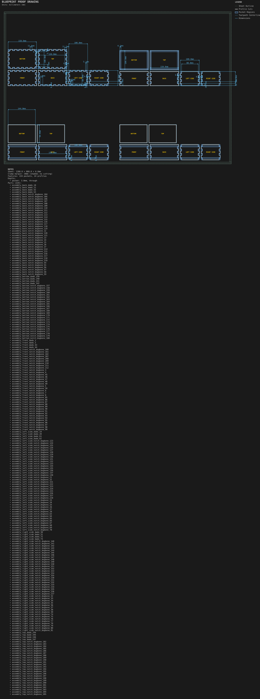

# Box bottoms and lids

**Demonstrates:** Box top and bottom joinery: captured, dado, finger and plug.

## What gets cut

Four small boxes that differ only in how the bottom and lid attach: captured, dado, finger, plug.

All finger-jointed side profiles span the specified 100mm box depth. See the
[coupon cutter-footprint proof](../../shop/joinery_test_coupons/finger-side-proof.svg).
The two cap-relief overlap reports remain; cap fit and engagement dimensions
still require the separate assembly audit.

Sheet 1200 × 800 × 6mm mdf.

- `pocket-3.17mm.nc`: pocket, 3.175mm tool, 24 feature(s), to 3mm
- `dogbone-3.17mm.nc`: dogbone, 3.175mm tool, 496 feature(s), to 6mm
- `profile-3.17mm.nc`: profile, 3.175mm tool, 24 feature(s), to 6.2mm

## Run

`python -m cli.mill --recipe docs/recipes/assemblies/box_bottoms_and_lids`

## Outputs

- `box_bottoms_and_lids.svg`
- `dogbone-3.17mm.nc`
- `machining_summary.json`
- `metrics.json`
- `pocket-3.17mm.nc`
- `profile-3.17mm.nc`
