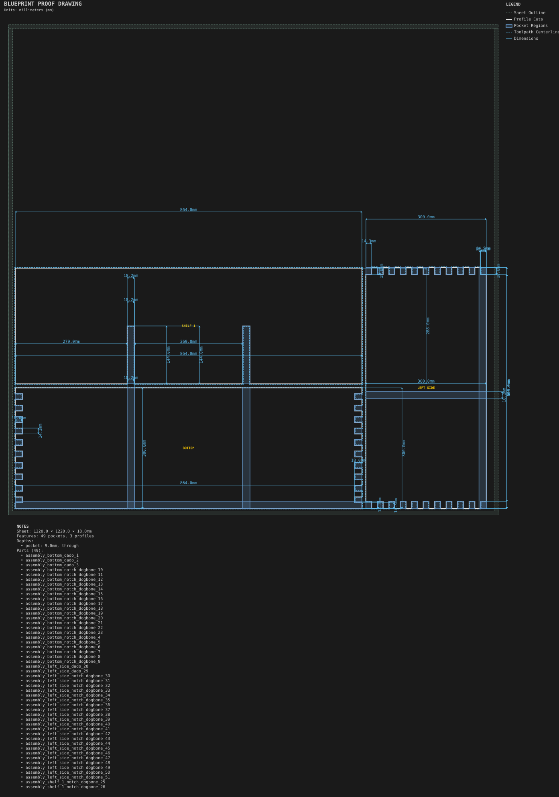
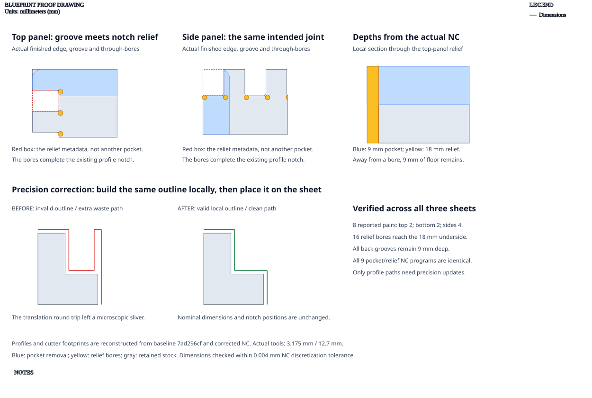

# Cubby organizer

**Demonstrates:** A cubby assembly with half-lap dividers, a finger-jointed perimeter and a captured back.

## What gets cut

A 3 × 2 cubby with half-lap dividers, a finger-jointed perimeter, and a captured back.

The back groove meets the finger-joint corner reliefs at both ends of each outer
panel. These eight intentional intersections now validate against the actual
notched profile, rather than treating relief metadata as separate pockets.
The groove remains 9mm deep; the relief bores cut through the 18mm stock.

Notched profiles are now built in local coordinates before sheet placement,
avoiding rounding slivers that could invalidate the outline. The proof checks
the eight reported pairs and their actual cuts on all three sheets within
0.004mm NC discretization tolerance. This addresses those machining reports;
the broader assembly audit still needs to verify perimeter/divider spans and
captured-back engagement against the intended assembled dimensions.

3 sheets.

Sheet 1: 1220 × 1220 × 18mm mdf.

- `sheet_1.pocket-12.70mm.nc`: pocket, 12.7mm tool, 6 feature(s), to 9mm
- `sheet_1.dogbone-12.70mm.nc`: dogbone, 12.7mm tool, 24 feature(s), to 9mm
- `sheet_1.dogbone-3.17mm.nc`: dogbone, 3.175mm tool, 44 feature(s), to 18mm
- `sheet_1.profile-3.17mm.nc`: profile, 3.175mm tool, 4 feature(s), to 18.2mm

Sheet 2: 1220 × 1220 × 18mm mdf.

- `sheet_2.pocket-12.70mm.nc`: pocket, 12.7mm tool, 5 feature(s), to 9mm
- `sheet_2.dogbone-12.70mm.nc`: dogbone, 12.7mm tool, 20 feature(s), to 9mm
- `sheet_2.dogbone-3.17mm.nc`: dogbone, 3.175mm tool, 88 feature(s), to 18mm
- `sheet_2.profile-3.17mm.nc`: profile, 3.175mm tool, 3 feature(s), to 18.2mm

Sheet 3: 1220 × 1220 × 18mm mdf.

- `sheet_3.pocket-12.70mm.nc`: pocket, 12.7mm tool, 2 feature(s), to 9mm
- `sheet_3.dogbone-12.70mm.nc`: dogbone, 12.7mm tool, 8 feature(s), to 9mm
- `sheet_3.dogbone-3.17mm.nc`: dogbone, 3.175mm tool, 44 feature(s), to 18mm
- `sheet_3.profile-3.17mm.nc`: profile, 3.175mm tool, 1 feature(s), to 18.2mm

## Run

`python -m cli.mill --recipe docs/recipes/assemblies/cubby_organizer`

## Outputs

- `cubby_organizer_sheet_2.svg`
- `cubby_organizer_sheet_3.svg`
- `machining_summary.json`
- `manifest.json`
- `metrics.json`
- `sheet_1.dogbone-12.70mm.nc`
- `sheet_1.dogbone-3.17mm.nc`
- `sheet_1.pocket-12.70mm.nc`
- `sheet_1.profile-3.17mm.nc`
- `sheet_2.dogbone-12.70mm.nc`
- `sheet_2.dogbone-3.17mm.nc`
- `sheet_2.pocket-12.70mm.nc`
- `sheet_2.profile-3.17mm.nc`
- `sheet_3.dogbone-12.70mm.nc`
- `sheet_3.dogbone-3.17mm.nc`
- `sheet_3.pocket-12.70mm.nc`
- `sheet_3.profile-3.17mm.nc`
