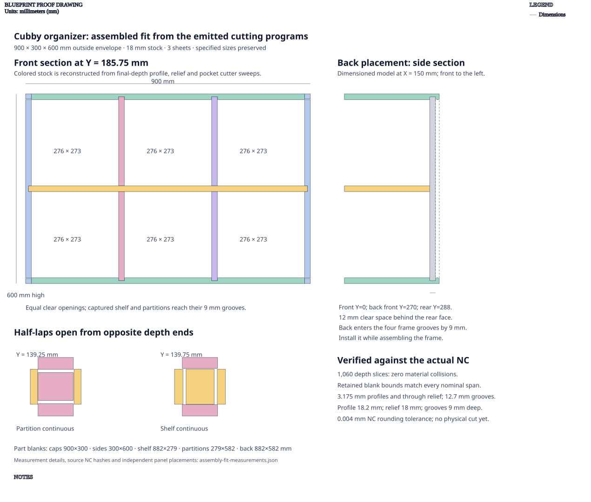

# Cubby organizer

**Demonstrates:** A cubby assembly with half-lap dividers, a finger-jointed perimeter and a captured back.

## What gets cut

A 900 × 300 × 600mm, 3 × 2 cubby with half-lap dividers, a finger-jointed perimeter, and a captured back. All parts use 18mm stock.

| Part | Blank size | Quantity |
|------|------------|----------|
| Top / bottom | 900 × 300mm | 2 |
| Sides | 300 × 600mm | 2 |
| Shelf | 882 × 279mm | 1 |
| Partitions | 279 × 582mm | 2 |
| Back | 882 × 582mm | 1 |

The six clear openings are each 276 × 273mm. Shelves, partitions and back
engage their receiving grooves by 9mm. Half-laps open from opposite depth ends;
their positions share the same assembly coordinates as the frame/back grooves.

`back_inset: 12mm` leaves 12mm clear behind the back's **rear face**. From the
front, that face sits at 288mm and its front face at 270mm. The back is captured
in four frame grooves and installed while assembling the frame.

The colored sections reconstruct retained material from actual emitted profile,
through-relief and pocket cutter sweeps. All eight retained blank bounds match
the specified spans within 0.004mm NC rounding tolerance; 1,060 depth slices
show no material interference. This is a computational check, not a physical
cut test. [Measurements and NC hashes](assembly-fit-measurements.json) record
its inputs, independent panel placements, sampling and results.

Generated notch relief now uses the notch cutout's center to orient the bores.
The former whole-panel reference left rounded material in mating corners;
nominal dimensions alone did not reveal that fit defect. Bore depths and tools
retain their specified values.

The earlier [groove/relief proof](groove-relief-proof.svg) documents the previous
validation and local-profile precision correction at commit `b8e64251`.
Its dimensions and bore locations are historical; use the assembly proof and
current outputs for this corrected design. A back groove may meet an existing
notch relief because they belong to the same proven cutout.

3 sheets.

Sheet 1: 1220 × 1220 × 18mm mdf.

- `sheet_1.pocket-12.70mm.nc`: pocket, 12.7mm tool, 6 feature(s), to 9mm
- `sheet_1.dogbone-12.70mm.nc`: dogbone, 12.7mm tool, 24 feature(s), to 9mm
- `sheet_1.dogbone-3.17mm.nc`: dogbone, 3.175mm tool, 42 feature(s), to 18mm
- `sheet_1.profile-3.17mm.nc`: profile, 3.175mm tool, 3 feature(s), to 18.2mm

Sheet 2: 1220 × 1220 × 18mm mdf.

- `sheet_2.pocket-12.70mm.nc`: pocket, 12.7mm tool, 3 feature(s), to 9mm
- `sheet_2.dogbone-12.70mm.nc`: dogbone, 12.7mm tool, 12 feature(s), to 9mm
- `sheet_2.dogbone-3.17mm.nc`: dogbone, 3.175mm tool, 46 feature(s), to 18mm
- `sheet_2.profile-3.17mm.nc`: profile, 3.175mm tool, 3 feature(s), to 18.2mm

Sheet 3: 1220 × 1220 × 18mm mdf.

- `sheet_3.pocket-12.70mm.nc`: pocket, 12.7mm tool, 4 feature(s), to 9mm
- `sheet_3.dogbone-12.70mm.nc`: dogbone, 12.7mm tool, 16 feature(s), to 9mm
- `sheet_3.dogbone-3.17mm.nc`: dogbone, 3.175mm tool, 88 feature(s), to 18mm
- `sheet_3.profile-3.17mm.nc`: profile, 3.175mm tool, 2 feature(s), to 18.2mm

## Run

`python -m cli.mill --recipe docs/recipes/assemblies/cubby_organizer`

## Outputs

- `cubby_organizer_sheet_1.svg`
- `cubby_organizer_sheet_2.svg`
- `cubby_organizer_sheet_3.svg`
- `machining_summary.json`
- `manifest.json`
- `metrics.json`
- `sheet_1.dogbone-12.70mm.nc`
- `sheet_1.dogbone-3.17mm.nc`
- `sheet_1.pocket-12.70mm.nc`
- `sheet_1.profile-3.17mm.nc`
- `sheet_2.dogbone-12.70mm.nc`
- `sheet_2.dogbone-3.17mm.nc`
- `sheet_2.pocket-12.70mm.nc`
- `sheet_2.profile-3.17mm.nc`
- `sheet_3.dogbone-12.70mm.nc`
- `sheet_3.dogbone-3.17mm.nc`
- `sheet_3.pocket-12.70mm.nc`
- `sheet_3.profile-3.17mm.nc`
