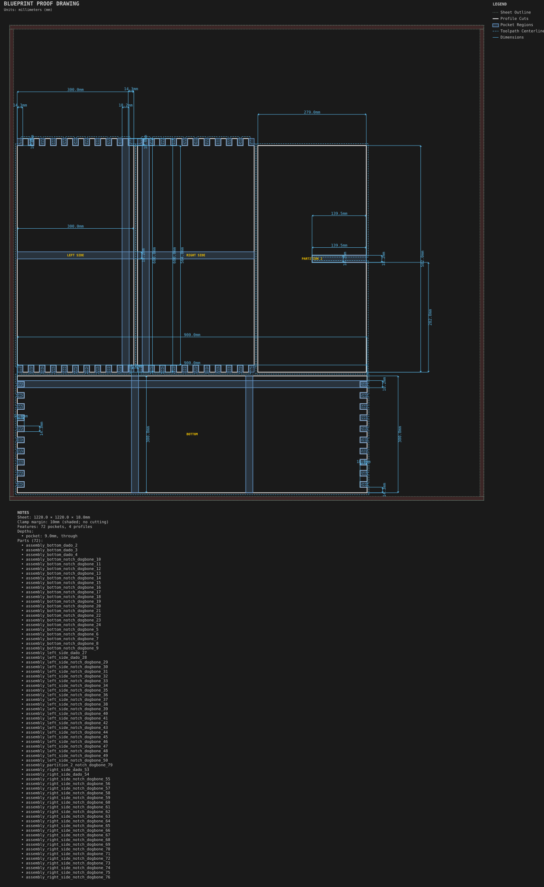

# Cubby organizer

**Demonstrates:** A cubby assembly with half-lap dividers, a finger-jointed perimeter and a captured back.

## What gets cut

A 900 × 300 × 600mm, 3 × 2 cubby with half-lap dividers, a finger-jointed perimeter, and a captured back. All parts use 18mm stock.

| Part | Blank size | Quantity |
|------|------------|----------|
| Top / bottom | 900 × 300mm | 2 |
| Sides | 300 × 600mm | 2 |
| Shelf | 882 × 279mm | 1 |
| Partitions | 279 × 582mm | 2 |
| Back | 882 × 582mm | 1 |

The six clear openings are each 276 × 273mm. Shelves, partitions and back
engage their receiving grooves by 9mm. Half-laps open from opposite depth ends;
their positions share the same assembly coordinates as the frame/back grooves.

`back_inset: 12mm` leaves 12mm clear behind the back's **rear face**. From the
front, that face sits at 288mm and its front face at 270mm. The back is captured
in four frame grooves and installed while assembling the frame.

Generated notch relief uses each notch cutout's center to orient the bores
and clear its mating corners. A back groove may meet an existing notch relief
when they belong to the same cutout.

2 sheets. The layout reserves the actual 3.175mm profile cutter at the clamp margin;
automatic spacing uses the selected cutter, while every nominal part/joinery dimension is unchanged.

2 sheets.

Sheet 1: 1220 × 1220 × 18mm mdf.

- `sheet_1.pocket-12.70mm.nc`: pocket, 12.7mm tool, 9 operation(s), to 9mm
- `sheet_1.dogbone-12.70mm.nc`: dogbone, 12.7mm tool, 36 operation(s), to 9mm
- `sheet_1.dogbone-3.17mm.nc`: dogbone, 3.175mm tool, 84 operation(s), to 18mm
- `sheet_1.profile-3.17mm.nc`: profile, 3.175mm tool, 47 contour(s), to 18.2mm

Sheet 2: 1220 × 1220 × 18mm mdf.

- `sheet_2.pocket-12.70mm.nc`: pocket, 12.7mm tool, 4 operation(s), to 9mm
- `sheet_2.dogbone-3.17mm.nc`: dogbone, 3.175mm tool, 92 operation(s), to 18mm
- `sheet_2.dogbone-12.70mm.nc`: dogbone, 12.7mm tool, 16 operation(s), to 9mm
- `sheet_2.profile-3.17mm.nc`: profile, 3.175mm tool, 41 contour(s), to 18.2mm

## Run

`python -m cli.mill --recipe docs/recipes/assemblies/cubby_organizer`

## Outputs

- `cubby_organizer_sheet_1.svg`
- `cubby_organizer_sheet_2.svg`
- `machining_summary.json`
- `manifest.json`
- `metrics.json`
- `sheet_1.dogbone-12.70mm.nc`
- `sheet_1.dogbone-3.17mm.nc`
- `sheet_1.pocket-12.70mm.nc`
- `sheet_1.profile-3.17mm.nc`
- `sheet_2.dogbone-12.70mm.nc`
- `sheet_2.dogbone-3.17mm.nc`
- `sheet_2.pocket-12.70mm.nc`
- `sheet_2.profile-3.17mm.nc`
