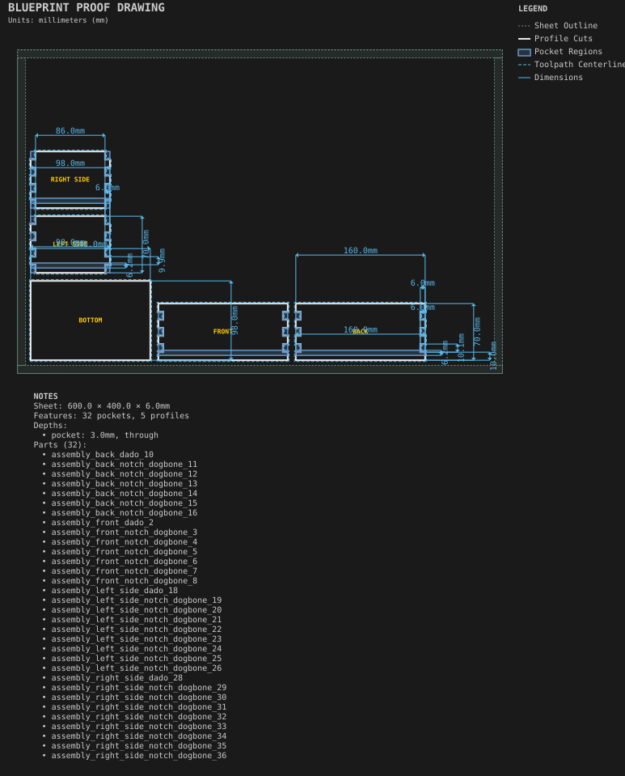

# Finger-jointed box

**Demonstrates:** A box assembly with finger-jointed sides, a captured bottom, labels and edge colours.

## What gets cut

A small 6mm box with finger-jointed sides and a captured bottom, labelled and edge-coloured for assembly.

The side profiles span the full specified 110mm box depth. The
[coupon cutter-footprint proof](../../shop/joinery_test_coupons/finger-side-proof.svg)
shows why finger-jointed sides must include the end fingers. Captured-bottom
engagement dimensions remain under the assembly fit audit.

Sheet 600 × 400 × 6mm mdf.

- `pocket-3.17mm.nc`: pocket, 3.175mm tool, 4 feature(s), to 3mm
- `dogbone-3.17mm.nc`: dogbone, 3.175mm tool, 72 feature(s), to 6mm
- `profile-3.17mm.nc`: profile, 3.175mm tool, 5 feature(s), to 6.2mm

## Run

`python -m cli.mill --recipe docs/recipes/assemblies/finger_jointed_box`

## Outputs

- `dogbone-3.17mm.nc`
- `finger_jointed_box.svg`
- `machining_summary.json`
- `metrics.json`
- `pocket-3.17mm.nc`
- `profile-3.17mm.nc`
