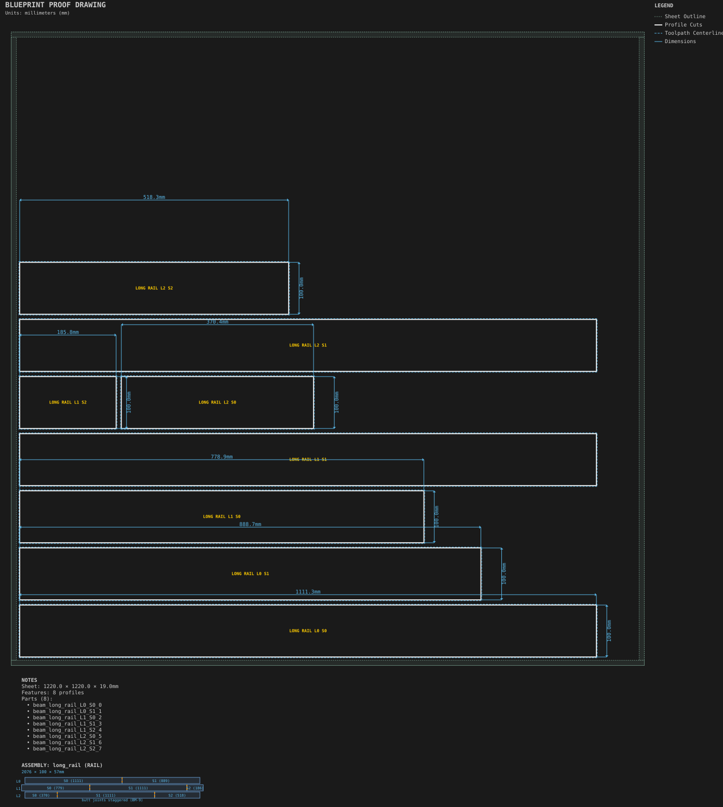
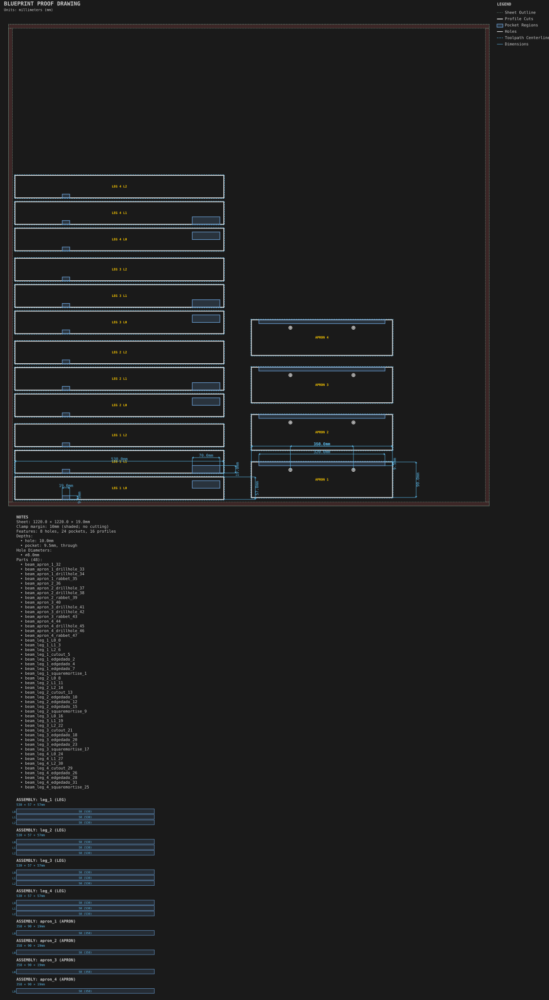

# Beams

Structural members laminated from sheet layers.

Generated by `python -m cli.recipes --regen`. Do not edit by hand.

## [Long spliced rail](long_spliced_rail/)

Beam splicing: layers longer than the sheet, spliced with staggered joints.

## [Side table frame](side_table_frame/)

Laminated beams with mortises, tenons, edge dados, rabbets and drill holes.
