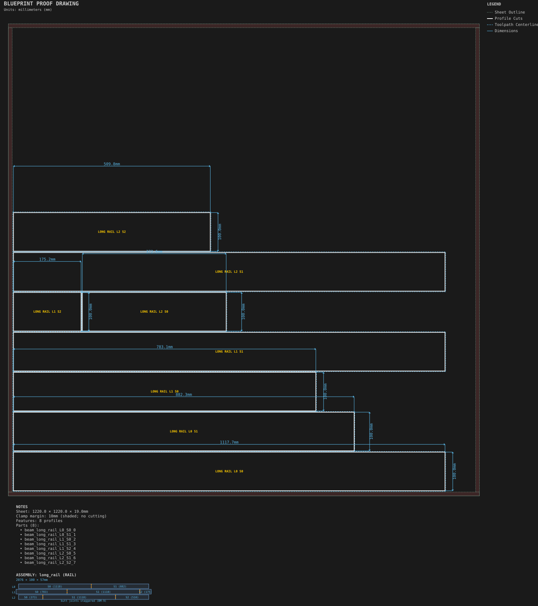

# Long spliced rail

**Demonstrates:** Beam splicing: layers longer than the sheet, spliced with staggered joints.

## What gets cut

A 2000mm laminated rail, longer than the sheet, spliced with staggered joints and tenoned at both ends.

Sheet 1220 × 1220 × 19mm mdf.

- `profile-9.53mm.nc`: profile, 9.525mm tool, 10 operation(s), to 19.2mm

## Run

`python -m cli.mill --recipe docs/recipes/beams/long_spliced_rail`

## Outputs

- `long_spliced_rail.svg`
- `machining_summary.json`
- `metrics.json`
- `profile-9.53mm.nc`
