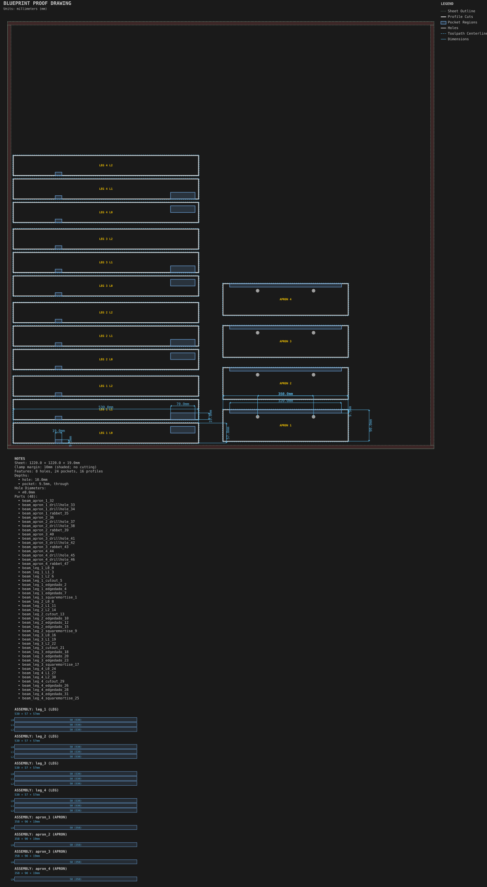

# Side table frame

**Demonstrates:** Laminated beams with mortises, tenons, edge dados, rabbets and drill holes.

## What gets cut

Four laminated legs with mortises and four aprons with tenons for a small side table.

Sheet 1220 × 1220 × 19mm mdf.

- `pocket-12.70mm.nc`: pocket, 12.7mm tool, 8 feature(s), to 19mm
- `pocket-6.35mm.nc`: pocket, 6.35mm tool, 16 feature(s), to 19mm
- `bore-3.17mm.nc`: bore, 3.175mm tool, 8 feature(s), to 10mm
- `profile-3.17mm.nc`: profile, 3.175mm tool, 64 feature(s), to 19.2mm

## Run

`python -m cli.mill --recipe docs/recipes/beams/side_table_frame`

## Outputs

- `bore-3.17mm.nc`
- `machining_summary.json`
- `metrics.json`
- `pocket-12.70mm.nc`
- `pocket-6.35mm.nc`
- `profile-3.17mm.nc`
- `side_table_frame.svg`
