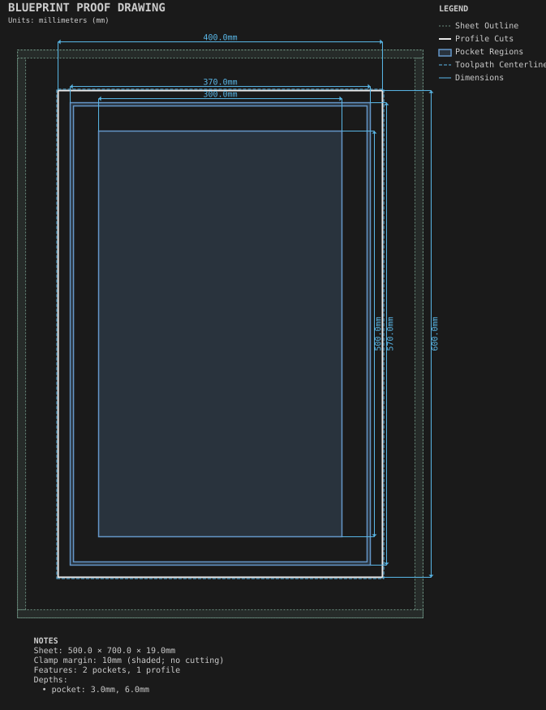
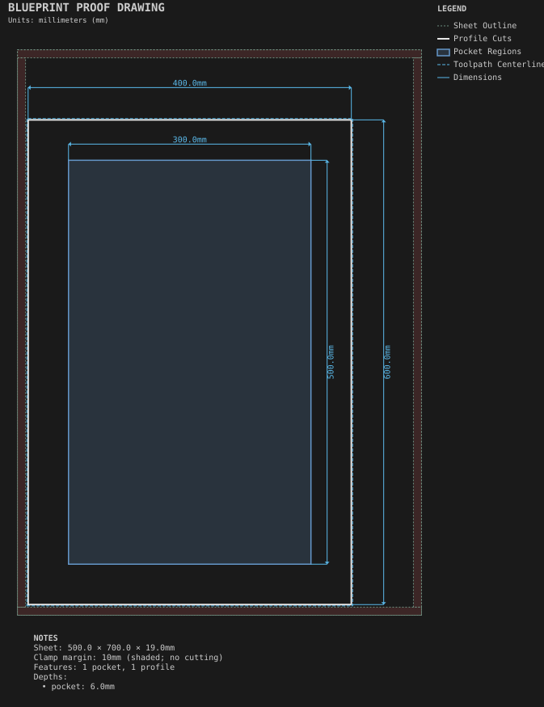
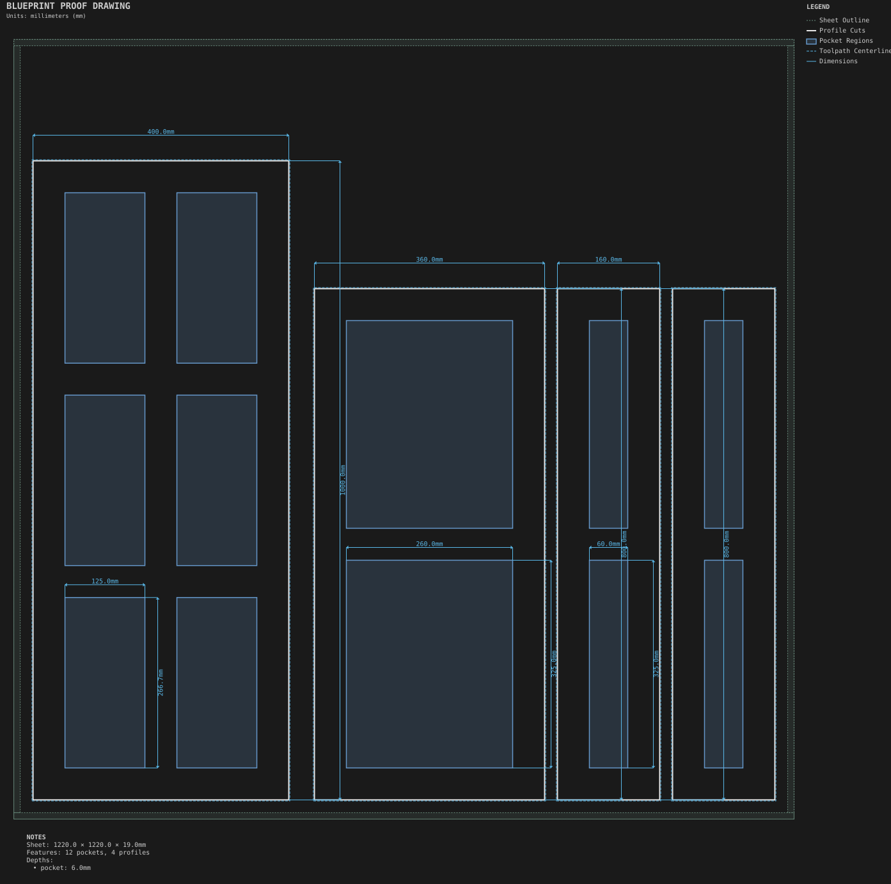
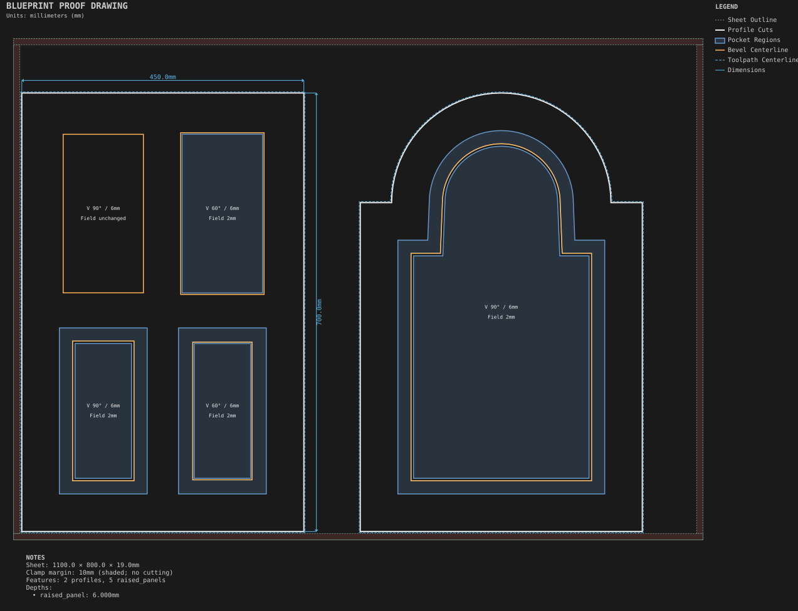

# Doors

One-piece cabinet doors cut from a single sheet of 19mm MDF.

Generated by `python -m cli.recipes --regen`. Do not edit by hand.

## [Decorated Shaker door](decorated_shaker_door/)

A face decoration combined with a frame: a groove cut around a Shaker door's frame.

## [Hinge-cup door](hinge_cup_door/)

Two-sided machining: features cut on the back of the sheet after a flip.

## [Multi-panel doors](multi_panel_doors/)

A reusable door component with parameter defaults and per-use overrides, plus the split layouts: Split, SplitGrid, SplitHorizontal and SplitVertical.

## [Raised-panel doors](raised_panel_doors/)

Three tool-matched raised-panel profiles in rectangular and arched doors.

## [Shaker door](shaker_door/)

A one-piece cabinet door: a through outline with tabs, a 50mm frame left at full thickness, and a center panel recessed 6mm.
