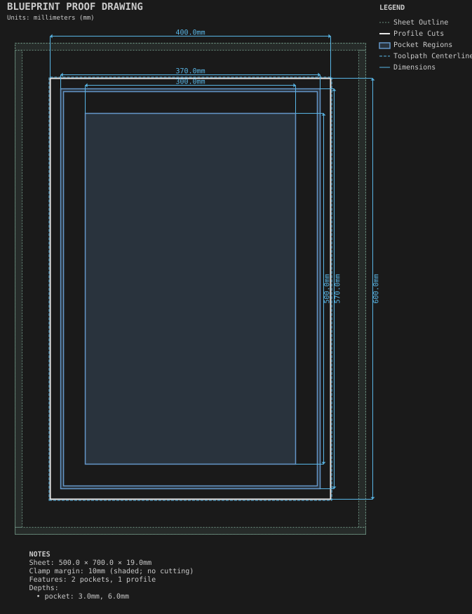

# Decorated Shaker door

**Demonstrates:** A face decoration combined with a frame: a groove cut around a Shaker door's frame.

## What gets cut

A Shaker door with a 4mm groove cut around the frame 15mm in from the edge, and the center panel recessed 6mm.

Sheet 500 × 700 × 19mm mdf.

- `pocket-3.17mm.nc`: pocket, 3.175mm tool, 1 feature(s), to 3mm
- `pocket-12.70mm.nc`: pocket, 12.7mm tool, 1 feature(s), to 6mm
- `profile-3.17mm.nc`: profile, 3.175mm tool, 1 feature(s), to 19.2mm

## Run

`python -m cli.mill --recipe docs/recipes/doors/decorated_shaker_door`

## Outputs

- `decorated_shaker_door.svg`
- `machining_summary.json`
- `metrics.json`
- `pocket-12.70mm.nc`
- `pocket-3.17mm.nc`
- `profile-3.17mm.nc`
