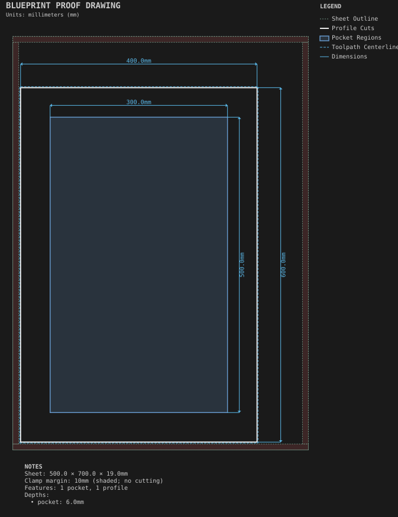

# Hinge-cup door

**Demonstrates:** Two-sided machining: features cut on the back of the sheet after a flip.

## What gets cut

A Shaker door with two 35mm Euro hinge cups machined from the back. Two setups, with the sheet flipped between them.

Sheet 500 × 700 × 19mm mdf.

- `back-bore-25.40mm.nc`: bore, 25.4mm tool, 2 feature(s), to 13mm
- `pocket-12.70mm.nc`: pocket, 12.7mm tool, 1 feature(s), to 6mm
- `profile-3.17mm.nc`: profile, 3.175mm tool, 1 feature(s), to 19.2mm

## Run

`python -m cli.mill --recipe docs/recipes/doors/hinge_cup_door`

## Outputs

- `back-bore-25.40mm.nc`
- `hinge_cup_door.back.svg`
- `hinge_cup_door.svg`
- `machining_summary.json`
- `metrics.json`
- `pocket-12.70mm.nc`
- `profile-3.17mm.nc`
