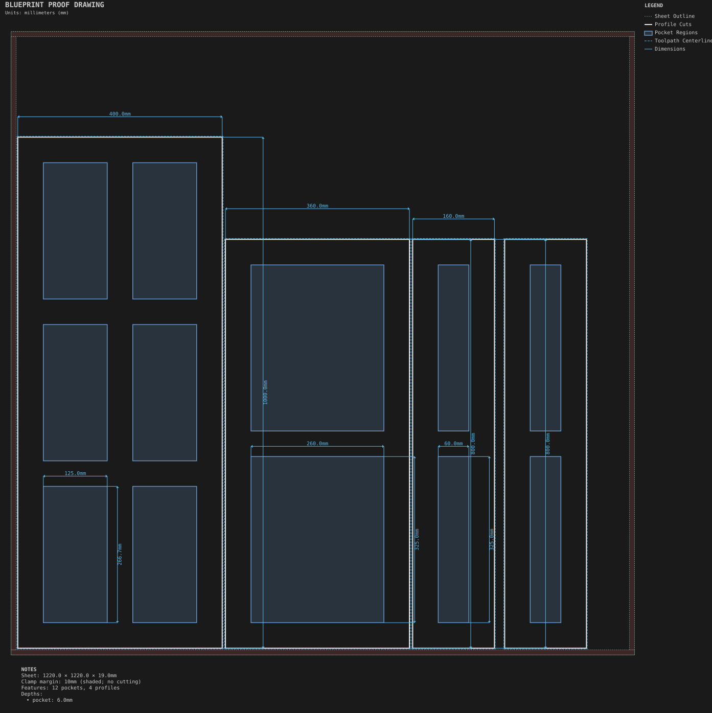

# Multi-panel doors

**Demonstrates:** A reusable door component with parameter defaults and per-use overrides, plus the split layouts: Split, SplitGrid, SplitHorizontal and SplitVertical.

## What gets cut

Four cabinet doors built from one reusable door outline: a 400 × 1000mm six-panel door, a 360 × 800mm two-panel door, and two 160 × 800mm narrow doors.

Sheet 1220 × 1220 × 19mm mdf.

- `pocket-9.53mm.nc`: pocket, 9.525mm tool, 12 operation(s), to 6mm
- `profile-9.53mm.nc`: profile, 9.525mm tool, 4 operation(s), to 19.2mm

## Run

`python -m cli.mill --recipe docs/recipes/doors/multi_panel_doors`

## Outputs

- `machining_summary.json`
- `metrics.json`
- `multi_panel_doors.svg`
- `pocket-9.53mm.nc`
- `profile-9.53mm.nc`
