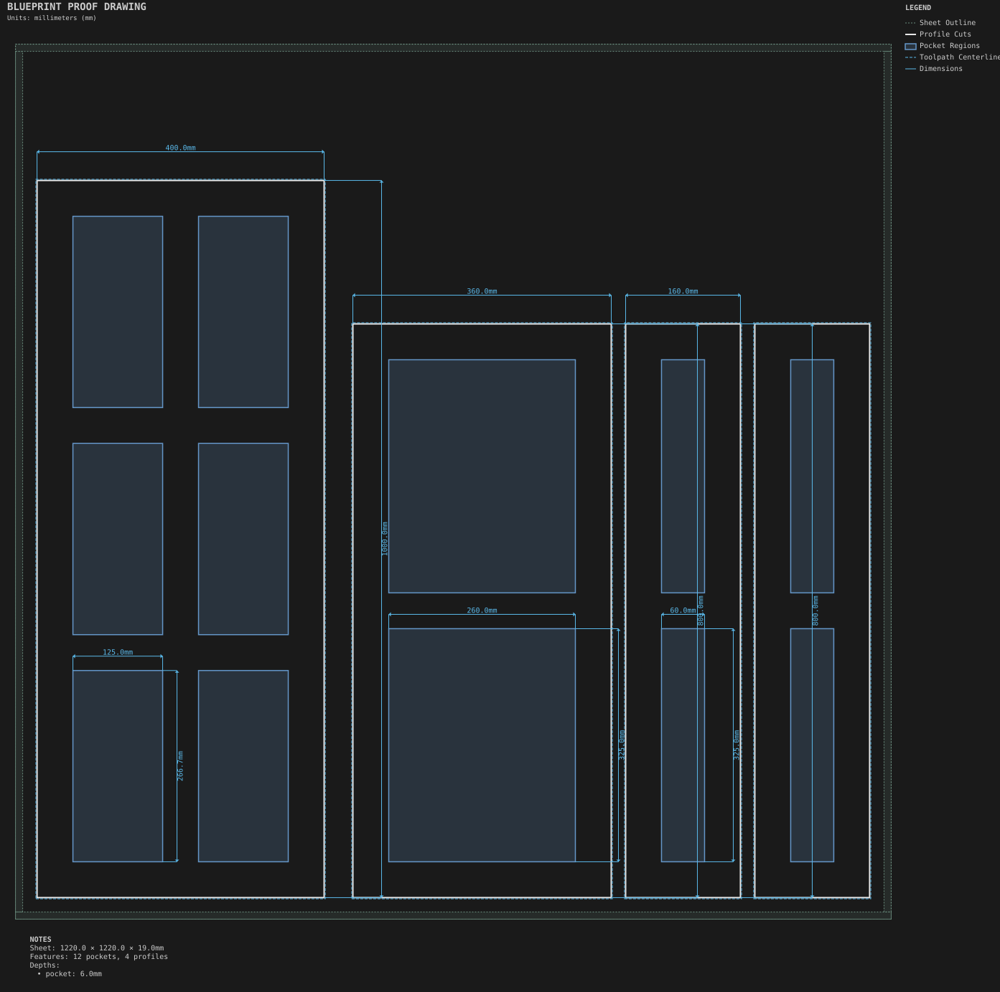
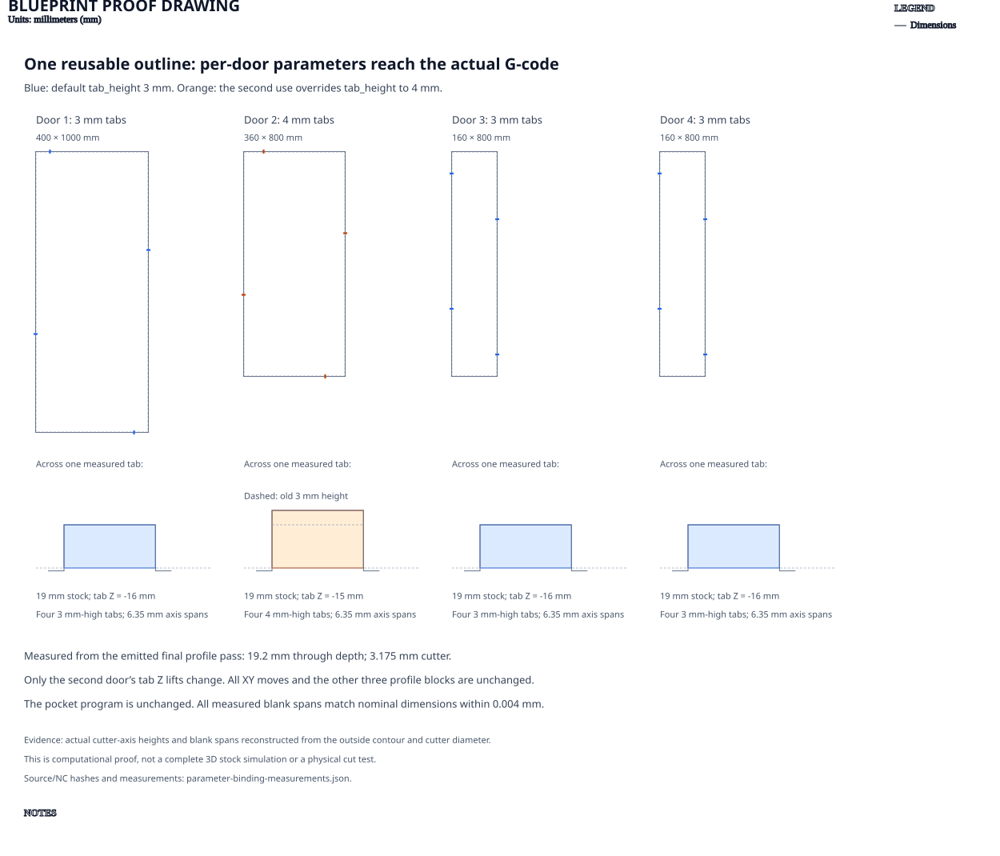

# Multi-panel doors

**Demonstrates:** A reusable door component with parameter defaults and per-use overrides, plus the split layouts: Split, SplitGrid, SplitHorizontal and SplitVertical.

## What gets cut

Four cabinet doors built from one reusable door outline: a 400 × 1000mm six-panel door, a 360 × 800mm two-panel door, and two 160 × 800mm narrow doors.

Sheet 1220 × 1220 × 19mm MDF, with a 10mm margin. Twelve panel recesses cut to 6mm with a 12.7mm tool. Four outside profiles cut through with a 3.175mm tool. The reusable outline defaults to four 3mm-high tabs; the second door overrides `tab_height` to 4mm. The other three uses retain the default.

## Parameter-binding proof

The same component body uses `tab_height: ${tab_height}`. Values bind before
dimension parsing, separately for each use. The actual final profile pass leaves
four tabs at Z−16mm on doors 1, 3 and 4, and Z−15mm on door 2: 3mm and 4mm above
the 19mm stock's bottom. Every tab has a 6.35mm cutter-axis span. Through cuts
still reach 19.2mm, and all four reconstructed blank spans match their nominal
dimensions within 0.004mm of NC rounding.

Only door 2's tab lifts change from the fixed-height version. Every XY move, the
other three profile blocks and the pocket program remain unchanged. The
[measurements and source/NC hashes](parameter-binding-measurements.json) record
the comparison. This proof shows actual cutter-axis heights and blank spans;
it is not a complete 3D stock simulation or a physical cut test.

## Run

`python -m cli.mill --recipe docs/recipes/doors/multi_panel_doors`

## Outputs

- `multi_panel_doors.svg`
- `pocket-12.70mm.nc`
- `profile-3.17mm.nc`
- `machining_summary.json`
- `metrics.json`
