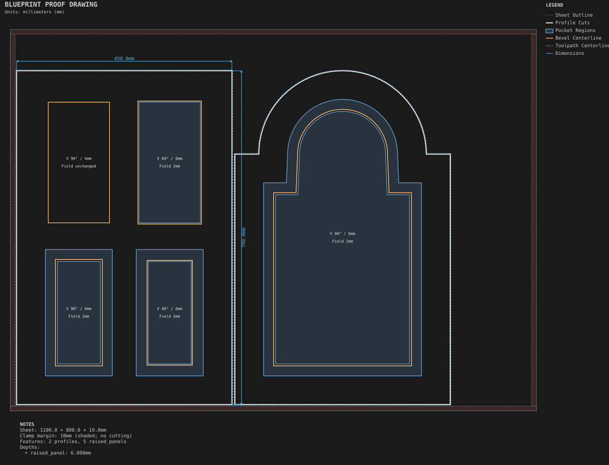

# Raised-panel doors

**Demonstrates:** Three tool-matched raised-panel profiles in rectangular and arched doors.

## Door type

These are one-piece raised panel doors. Each door is carved from a single sheet:
`RaisedPanel` cuts the recess, slope and field into the board, and the uncut
border is the frame. A 5-piece door is different: it is assembled from two
stiles, two rails and a separate floating panel. This recipe does not make
5-piece doors.

## What gets cut

The doors are each 450 × 700mm, with a 60mm frame. The rectangular door has a
50mm gap between panel cells. All recess bottoms are 6mm below the original
face. A 2mm field is still 4mm above that bottom: “raised” refers to this relative
height, not material added above the board.

| Cell in blueprint | Profile | Center below face | Border to field |
|-------------------|---------|-------------------|-----------------|
| Bottom left | Flat gutter + 90° V-bit slope | 2mm | 25mm |
| Bottom right | Flat gutter + 60° V-bit slope | 2mm | 25mm |
| Top left | Plain 90° V-groove | 0mm, untouched | 12mm |
| Top right | 60° V-groove + pocketed center | 2mm | 5.774mm |
| Arched door | Flat gutter + 90° V-bit slope | 2mm | 25mm |

For the 90° gutter, 21mm of flat floor leads into a 4mm-wide 45° slope. The
60° gutter has a narrower 2.309mm slope and a 22.691mm floor. Offset-contour
pocket clearing cuts the gutter and field; layered V-bit contours form the
slope. There is no surface raster or ball-nose machining.

This resolves #241 under the owner's clarified profile choice. The previous
implementation ignored the 6mm border depth and ran a groove outside the cell
to 6.699mm. The original proposed continuous shallow 25mm slope was replaced
explicitly by these tool-matched profiles; that arbitrary slope is not supported.

Sheet 1100 × 800 × 19mm mdf.

- `pocket_offset-9.53mm.nc`: pocket_offset, 9.525mm tool, 7 operation(s), to 6mm
- `edge-12.70mm-90deg.nc`: edge, 12.7mm tool, 3 operation(s), to 6mm
- `edge-12.70mm-60deg.nc`: edge, 12.7mm tool, 2 operation(s), to 6mm
- `profile-9.53mm.nc`: profile, 9.525mm tool, 2 operation(s), to 19.2mm

## Run

`python -m cli.mill --recipe docs/recipes/doors/raised_panel_doors`

## Outputs

- `edge-12.70mm-60deg.nc`
- `edge-12.70mm-90deg.nc`
- `machining_summary.json`
- `metrics.json`
- `pocket_offset-9.53mm.nc`
- `profile-9.53mm.nc`
- `raised_panel_doors.svg`
