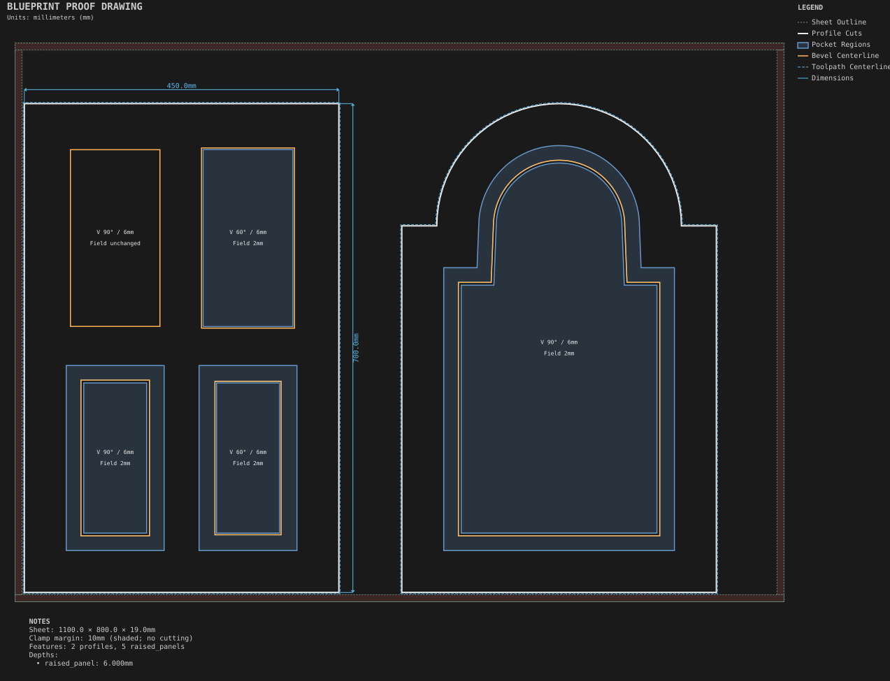

# Raised-panel doors

**Demonstrates:** Raised panels in a split grid and in an arched door.

## What gets cut

The intended build is a four-panel raised door and a cathedral-arch raised door,
side by side. Current output has unresolved raised-panel and overlap errors under
#238/#241; placement also remains under review. The colored bevel centerlines and
6.699mm depth labels show the current machining plan, including its errors.

Sheet 1100 × 800 × 19mm mdf.

- `pocket-12.70mm.nc`: pocket, 12.7mm tool, 5 feature(s), to 2mm
- `edge-12.70mm.nc`: edge, 12.7mm tool, 5 feature(s), to 6.699mm
- `profile-3.17mm.nc`: profile, 3.175mm tool, 2 feature(s), to 19.2mm

## Run

`python -m cli.mill --recipe docs/recipes/doors/raised_panel_doors`

## Outputs

- `edge-12.70mm.nc`
- `machining_summary.json`
- `metrics.json`
- `pocket-12.70mm.nc`
- `profile-3.17mm.nc`
- `raised_panel_doors.svg`
