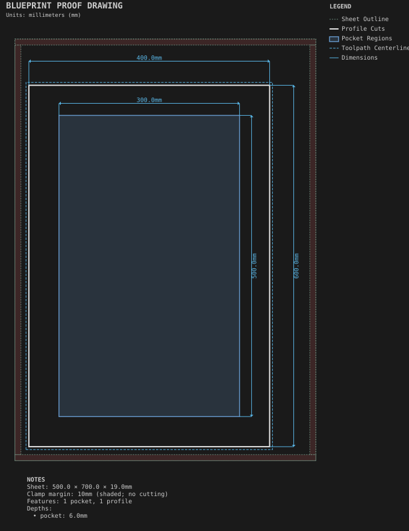

# Shaker door

**Demonstrates:** A one-piece cabinet door: a through outline with tabs, a 50mm frame left at full thickness, and a center panel recessed 6mm.

## What gets cut

A 400 × 600mm door. The outline is cut through with tabs, the 50mm frame stays at full thickness, and the center panel is recessed 6mm.

Sheet 500 × 700 × 19mm mdf.

- `pocket-9.53mm.nc`: pocket, 9.525mm tool, 1 operation(s), to 6mm
- `profile-9.53mm.nc`: profile, 9.525mm tool, 1 operation(s), to 19.2mm

## Run

`python -m cli.mill --recipe docs/recipes/doors/shaker_door`

## Outputs

- `machining_summary.json`
- `metrics.json`
- `pocket-9.53mm.nc`
- `profile-9.53mm.nc`
- `shaker_door.svg`
