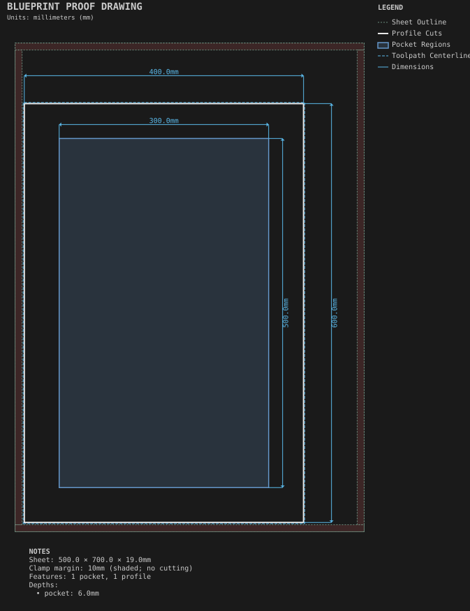
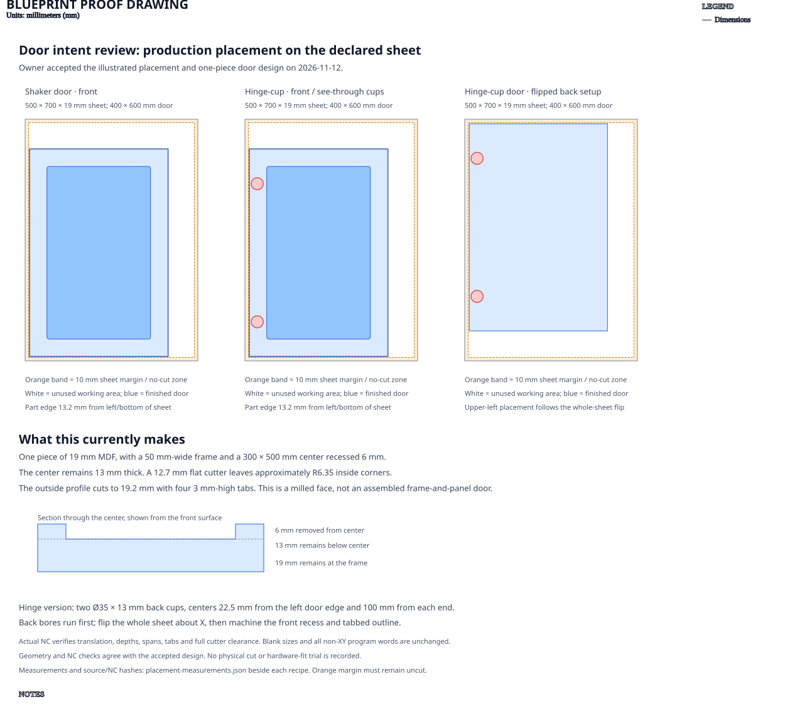

# Shaker door

**Demonstrates:** A one-piece cabinet door: a through outline with tabs, a 50mm frame left at full thickness, and a center panel recessed 6mm.

## What gets cut

A 400 × 600mm door. The outline is cut through with tabs, the 50mm frame stays at full thickness, and the center panel is recessed 6mm.

Sheet 500 × 700 × 19mm mdf.

The door's lower-left edge is 13.2mm from the physical sheet edges: the 10mm
**sheet margin** is a no-cut zone, followed by 3.2mm for the outside-profile
cutter. Its 3.175mm cutting diameter stays wholly inside the working area.
The declared sheet size is retained, leaving the larger offcut above/right.

## Intent review

This currently produces a single piece of 19mm MDF with a milled Shaker-style
face. The center pocket is 300 × 500mm, 6mm deep, leaving 13mm of material below
it and approximately R6.35 inside corners. The surrounding 50mm frame stays at
full thickness. Four 3mm-high tabs retain the outside profile.

Placement follows the owner's production-layout preference. The door's
construction and machining design remain subject to the owner's intent review.
[Measurements and source/NC hashes](placement-measurements.json) verify the
translated programs, nominal spans, pocket extent, tabs and full cutter-radius
clearance. Z depths, feeds, RPM and other non-XY program words are unchanged;
the final machine-origin parking move is unchanged. This is computational
evidence, not a physical cut test.

## Machining programs

- `pocket-12.70mm.nc`: pocket, 12.7mm tool, 1 feature(s), to 6mm
- `profile-3.17mm.nc`: profile, 3.175mm tool, 1 feature(s), to 19.2mm

## Run

`python -m cli.mill --recipe docs/recipes/doors/shaker_door`

## Outputs

- `machining_summary.json`
- `metrics.json`
- `pocket-12.70mm.nc`
- `profile-3.17mm.nc`
- `shaker_door.svg`
