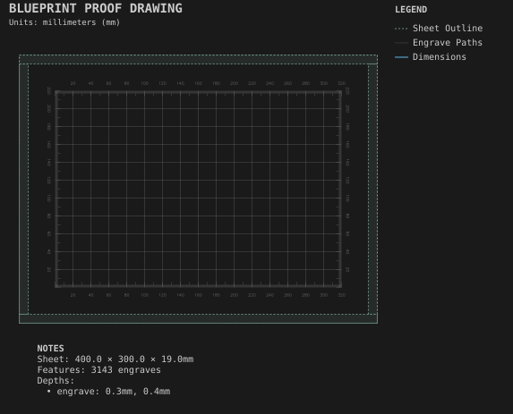
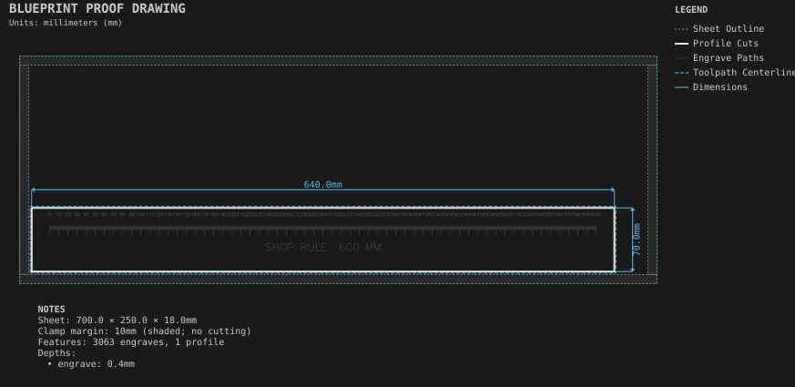
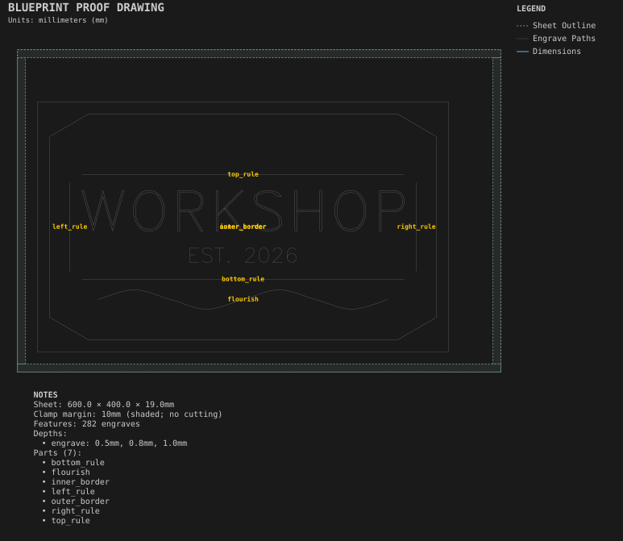
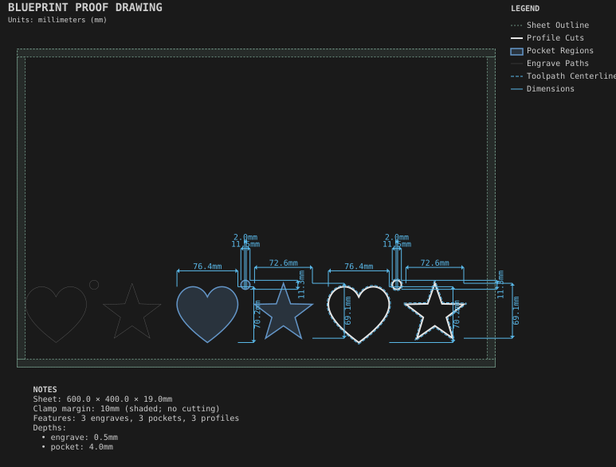

# Engraving

Shallow V-bit and engraving work: text, logos, and measuring tools.

Generated by `python -m cli.recipes --regen`. Do not edit by hand.

## [Layout board](layout_board/)

A labelled measurement grid and plain grid lines.

## [Shop ruler](shop_ruler/)

Measurement ticks and engraved text.

## [Sign](sign/)

Engraved text with line, polyline and spline borders.

## [SVG artwork](svg_artwork/)

Artwork from an SVG file, engraved, pocketed and cut through.
