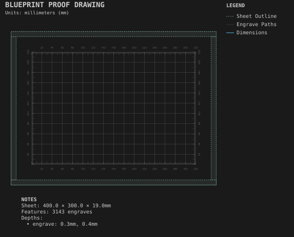

# Layout board

**Demonstrates:** A labelled measurement grid and plain grid lines.

## What gets cut

A layout board engraved with a measurement grid and labelled grid lines.

Sheet 400 × 300 × 19mm mdf.

- `engrave-1.00mm.nc`: engrave, 1mm tool, 3143 feature(s), to 0.4mm

## Run

`python -m cli.mill --recipe docs/recipes/engraving/layout_board`

## Outputs

- `engrave-1.00mm.nc`
- `layout_board.svg`
- `machining_summary.json`
- `metrics.json`
