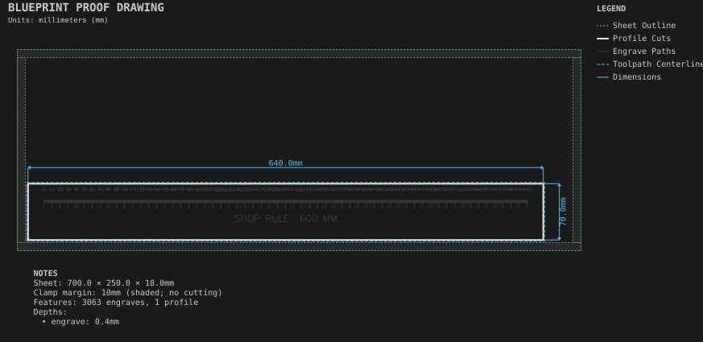

# Shop ruler

**Demonstrates:** Measurement ticks and engraved text.

## What gets cut

A 600mm ruler with 1mm ticks, longer ticks every 10mm, and numbered labels
every 20mm (0, 20, 40, …, 600), cut out with a through profile.

Sheet 700 × 250 × 18mm mdf.

- `engrave-1.00mm.nc`: engrave, 1mm tool, 1996 feature(s), to 0.4mm
- `profile-3.17mm.nc`: profile, 3.175mm tool, 1 feature(s), to 18.2mm

## Run

`python -m cli.mill --recipe docs/recipes/engraving/shop_ruler`

## Outputs

- `engrave-1.00mm.nc`
- `machining_summary.json`
- `metrics.json`
- `profile-3.17mm.nc`
- `shop_ruler.svg`
