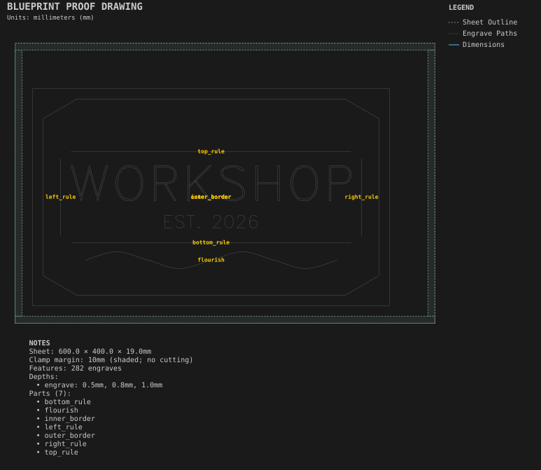

# Sign

**Demonstrates:** Engraved text with line, polyline and spline borders.

## What gets cut

A shop sign with engraved text and engraved line and spline borders.

Sheet 600 × 400 × 19mm mdf.

- `engrave-1.00mm.nc`: engrave, 1mm tool, 282 feature(s), to 1mm

## Run

`python -m cli.mill --recipe docs/recipes/engraving/sign`

## Outputs

- `engrave-1.00mm.nc`
- `machining_summary.json`
- `metrics.json`
- `sign.svg`
