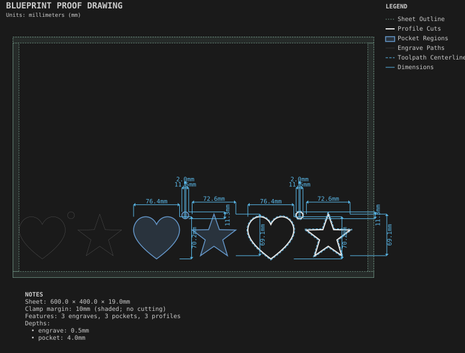

# SVG artwork

**Demonstrates:** Artwork from an SVG file, engraved, pocketed and cut through.

## What gets cut

Artwork from an SVG file in the recipe folder, cut three ways: engraved, pocketed, and cut through.

Sheet 600 × 400 × 19mm mdf.

- `pocket-12.70mm.nc`: pocket, 12.7mm tool, 2 feature(s), to 4mm
- `pocket-9.53mm.nc`: pocket, 9.525mm tool, 1 feature(s), to 4mm
- `engrave-1.00mm.nc`: engrave, 1mm tool, 3 feature(s), to 0.5mm
- `profile-3.17mm.nc`: profile, 3.175mm tool, 3 feature(s), to 19.2mm

## Run

`python -m cli.mill --recipe docs/recipes/engraving/svg_artwork`

## Outputs

- `engrave-1.00mm.nc`
- `machining_summary.json`
- `metrics.json`
- `pocket-12.70mm.nc`
- `pocket-9.53mm.nc`
- `profile-3.17mm.nc`
- `svg_artwork.svg`
