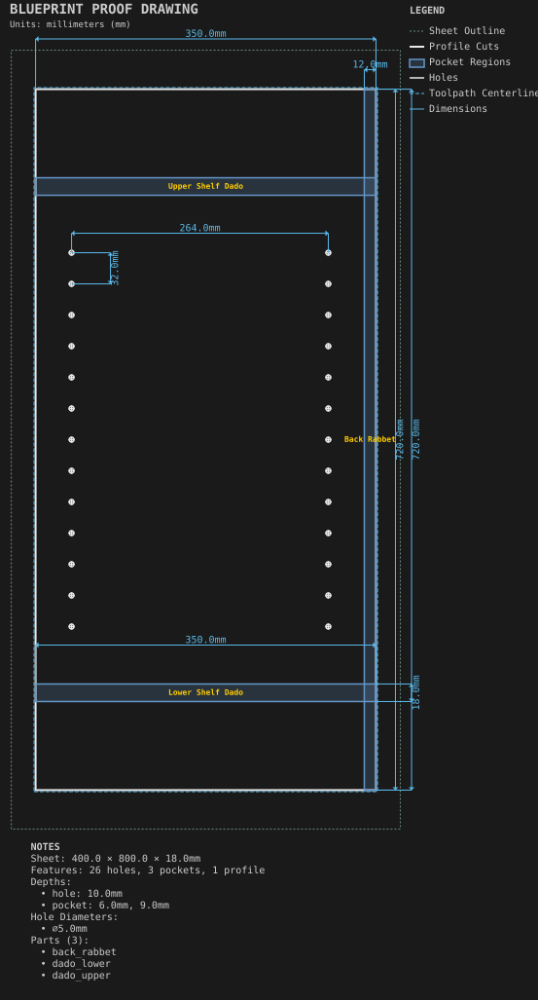
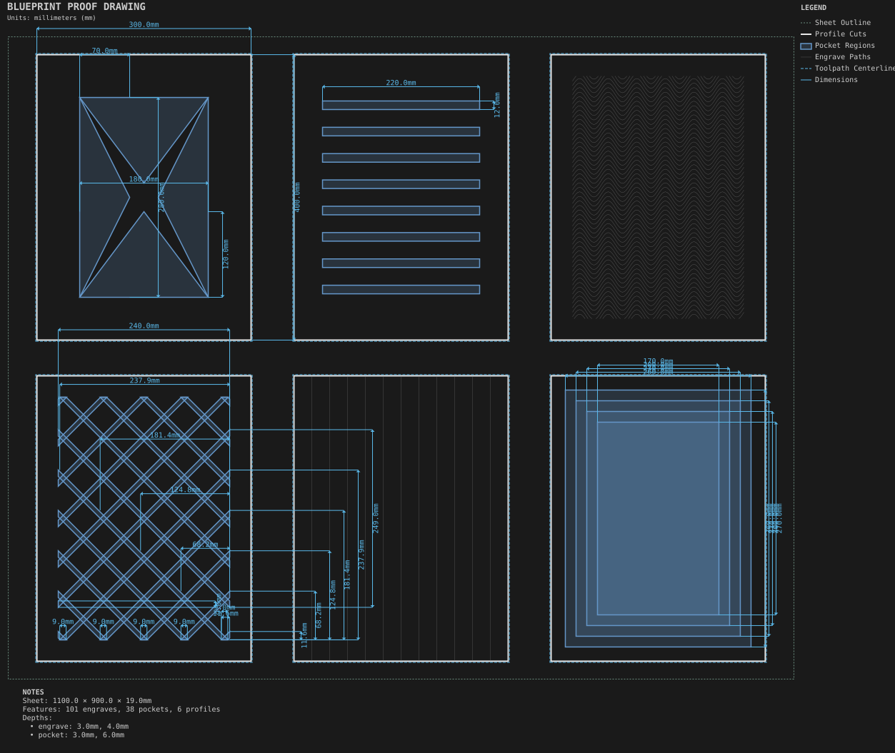
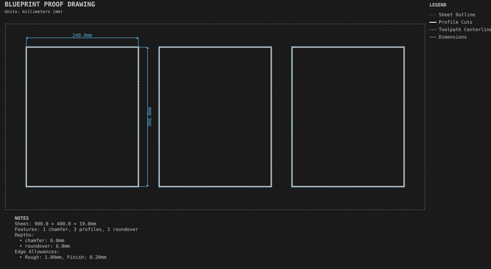
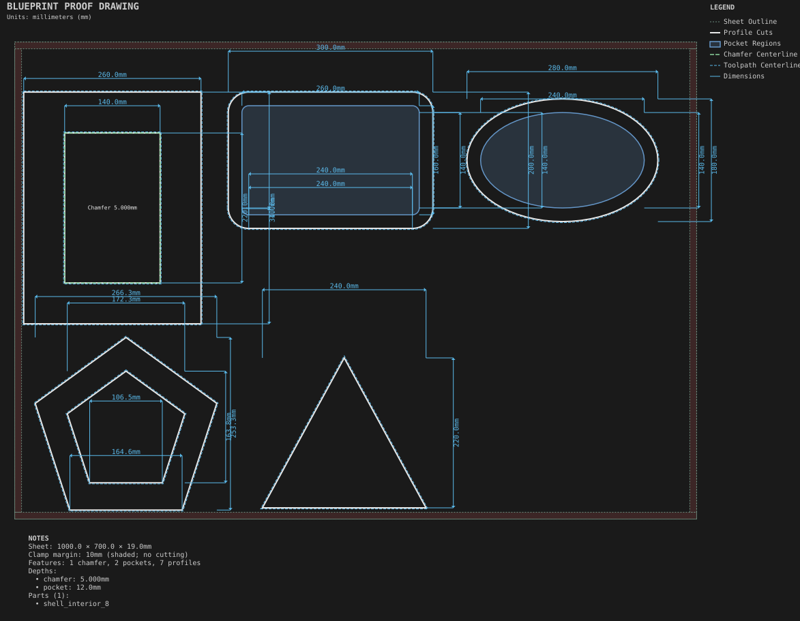
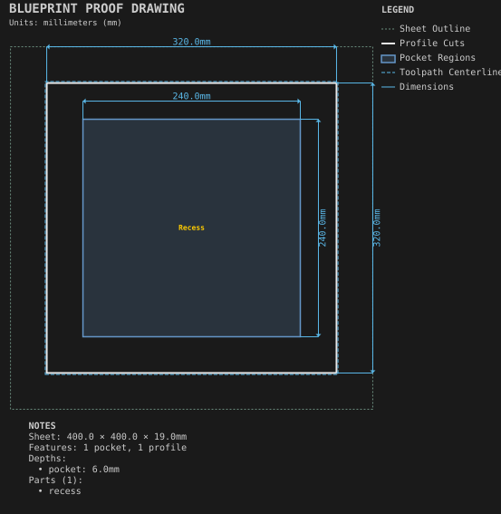
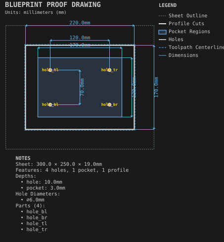

# Panels

Flat parts: decorative faces, edge styles, frames, trays, and casework panels.

Generated by `python -m cli.recipes --regen`. Do not edit by hand.

## [Cabinet side](cabinet_side/)

Hole grids, dados and a rabbet at mixed depths on one casework panel.

## [Decorative panel faces](decorative_panel_faces/)

Six face decorations side by side: X-panel, louvers, wave, lattice, fluting and concentric border.

## [Edge treatments](edge_treatments/)

Chamfer, roundover, and rough and finish allowances with a cross-section callout.

## [Frames and trays](frames_and_trays/)

Non-rectangular outlines, inside profiles, Subtract and Shell.

## [Pocket with island](pocket_with_island/)

A pocket that leaves an island of material standing.

## [Recessed mounting plate](recessed_mounting_plate/)

Holes drilled through the floor of a pocket.
