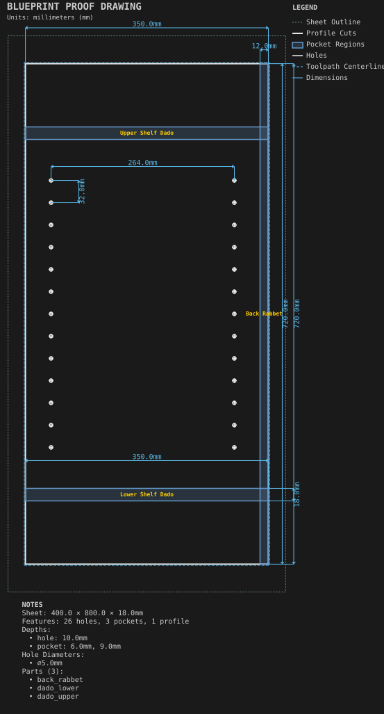

# Cabinet side

**Demonstrates:** Hole grids, dados and a rabbet at mixed depths on one casework panel.

## What gets cut

An 18mm cabinet side with two shelf dados, two rows of 5mm shelf-pin holes, and a rabbet along the back edge.

Sheet 400 × 800 × 18mm mdf.

- `pocket-12.70mm.nc`: pocket, 12.7mm tool, 2 feature(s), to 6mm
- `pocket-9.53mm.nc`: pocket, 9.525mm tool, 1 feature(s), to 9mm
- `bore-3.17mm.nc`: bore, 3.175mm tool, 26 feature(s), to 10mm
- `profile-3.17mm.nc`: profile, 3.175mm tool, 1 feature(s), to 18.2mm

## Run

`python -m cli.mill --recipe docs/recipes/panels/cabinet_side`

## Outputs

- `bore-3.17mm.nc`
- `cabinet_side.svg`
- `machining_summary.json`
- `metrics.json`
- `pocket-12.70mm.nc`
- `pocket-9.53mm.nc`
- `profile-3.17mm.nc`
