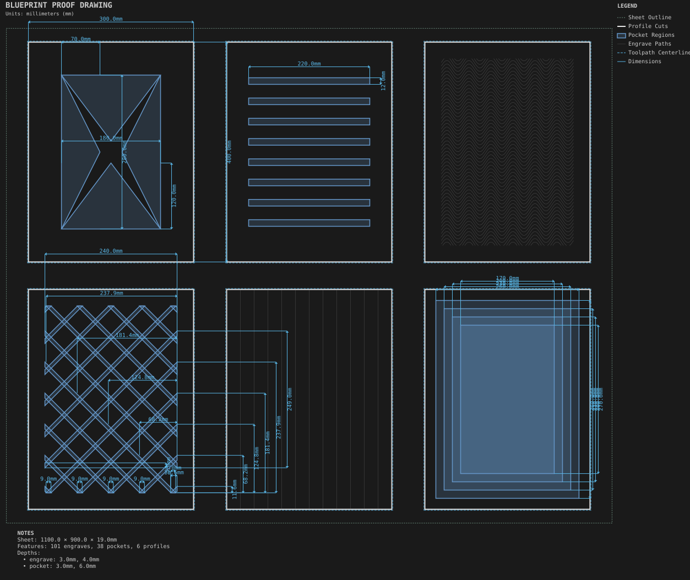

# Decorative panel faces

**Demonstrates:** Six face decorations side by side: X-panel, louvers, wave, lattice, fluting and concentric border.

## What gets cut

Six 300 × 400mm panels, one per face style: X-panel, louvers, wave, diamond lattice, fluting, concentric border.

The diamond lattice intentionally crosses two families of 6.35mm-wide grooves,
both 3mm deep, at right angles. Rotating the pattern does not change whether
those crossings are valid.

Sheet 1100 × 900 × 19mm mdf.

- `pocket-12.70mm.nc`: pocket, 12.7mm tool, 4 feature(s), to 6mm
- `pocket-9.53mm.nc`: pocket, 9.525mm tool, 8 feature(s), to 6mm
- `pocket-3.17mm.nc`: pocket, 3.175mm tool, 26 feature(s), to 3mm
- `engrave-1.00mm.nc`: engrave, 1mm tool, 101 feature(s), to 4mm
- `profile-3.17mm.nc`: profile, 3.175mm tool, 6 feature(s), to 19.2mm

## Run

`python -m cli.mill --recipe docs/recipes/panels/decorative_panel_faces`

## Outputs

- `decorative_panel_faces.svg`
- `engrave-1.00mm.nc`
- `machining_summary.json`
- `metrics.json`
- `pocket-12.70mm.nc`
- `pocket-3.17mm.nc`
- `pocket-9.53mm.nc`
- `profile-3.17mm.nc`
