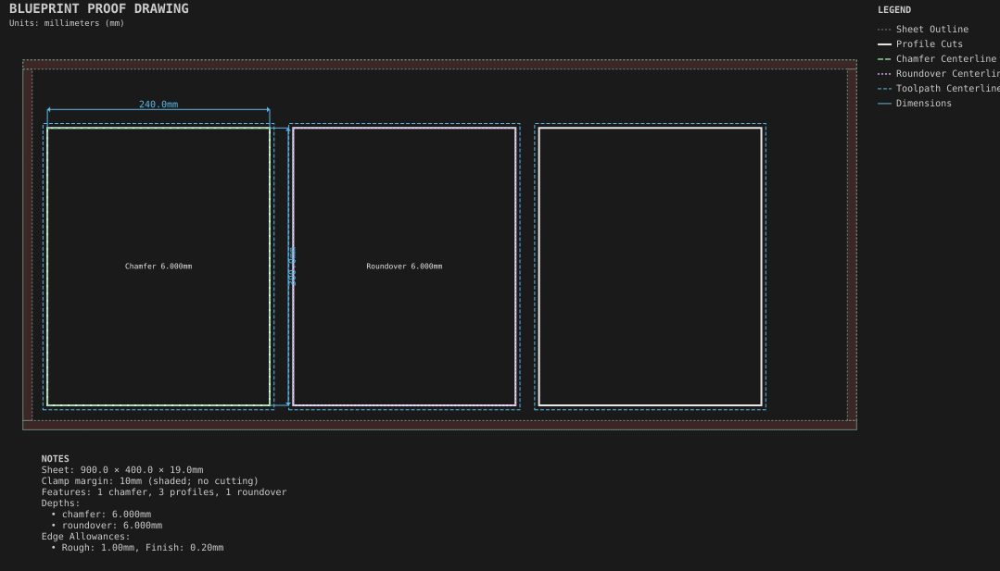

# Edge treatments

**Demonstrates:** Chamfer, roundover, and rough and finish allowances with a cross-section callout.

## What gets cut

Three small panels request different outside edges: a chamfer, a roundover, and a profile with rough and finish allowances shown as a cross-section callout.

The tool library includes `Example 6mm point roundover`, an owner-authorized
recipe tool. It models a bearingless R6 quarter-circle cutter with 12mm cutting
diameter, a 6mm shank and no nose extension. Its MDF feeds are example values:
18,000rpm, 720mm/min cutting feed, 180mm/min plunge feed and 1mm stepdown.
This is a software demonstration entry, not verified shop inventory or a
manufacturer feed recommendation. Match the geometry and feeds to the actual
tool before machining.

The roundover axis follows the nominal outline and reaches 6mm depth in six
layers. Its nose radius is zero (`12/2 - 6`); a wider-nose cutter would need an
axis offset equal to its nose radius, not its rounding radius. The selected
rounding radius must match the request within 0.001mm. Missing or mismatched
tooling still blocks the affected setup's G-code.

All three panels retain their declared 240 × 300mm outlines. The allowance panel
deliberately keeps its specified 0.2mm finish allowance after the 1mm rough pass.
The roundover changes the upper 6mm of the edge; the lower nominal edge remains.

The chamfer tip follows the nominal edge to produce the requested 6 × 6mm bevel
with the available 90° V-bit.

Sheet 900 × 400 × 19mm mdf.

- `edge-12.70mm.nc`: edge, 12.7mm tool, 1 operation(s), to 6mm
- `edge-12.00mm.nc`: edge, 12mm tool, 1 operation(s), to 6mm
- `profile-9.53mm.nc`: profile, 9.525mm tool, 3 operation(s), to 19.2mm
- `finish-9.53mm.nc`: finish, 9.525mm tool, 1 operation(s), to 19.2mm

## Run

`python -m cli.mill --recipe docs/recipes/panels/edge_treatments`

## Outputs

- `edge-12.00mm.nc`
- `edge-12.70mm.nc`
- `edge_treatments.svg`
- `finish-9.53mm.nc`
- `machining_summary.json`
- `metrics.json`
- `profile-9.53mm.nc`
