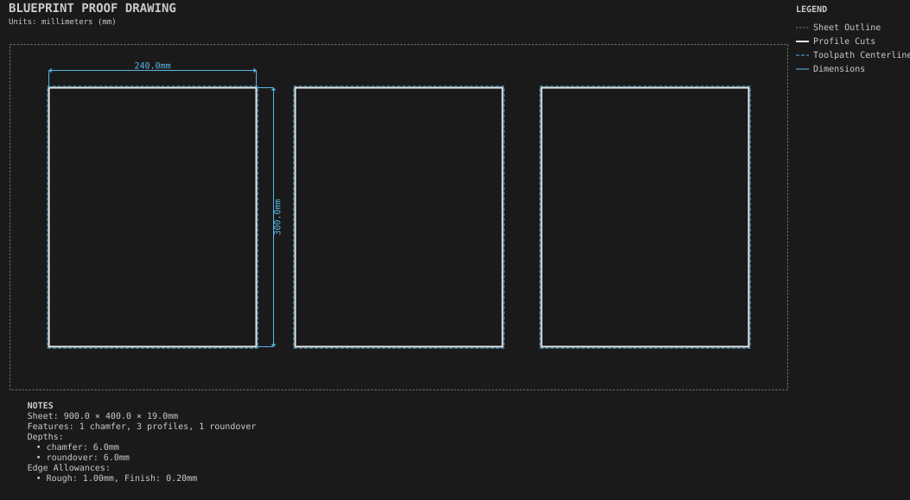

# Edge treatments

**Demonstrates:** Chamfer, roundover, and rough and finish allowances with a cross-section callout.

## What gets cut

Three small panels with different outside edges: a chamfer, a roundover, and a profile with rough and finish allowances shown as a cross-section callout.

Sheet 900 × 400 × 19mm mdf.

- `edge-12.70mm.nc`: edge, 12.7mm tool, 1 feature(s), to 6mm
- `profile-3.17mm.nc`: profile, 3.175mm tool, 3 feature(s), to 19.2mm
- `finish-3.17mm.nc`: finish, 3.175mm tool, 1 feature(s), to 19.2mm

## Run

`python -m cli.mill --recipe docs/recipes/panels/edge_treatments`

## Outputs

- `edge-12.70mm.nc`
- `edge_treatments.svg`
- `finish-3.17mm.nc`
- `machining_summary.json`
- `metrics.json`
- `profile-3.17mm.nc`
