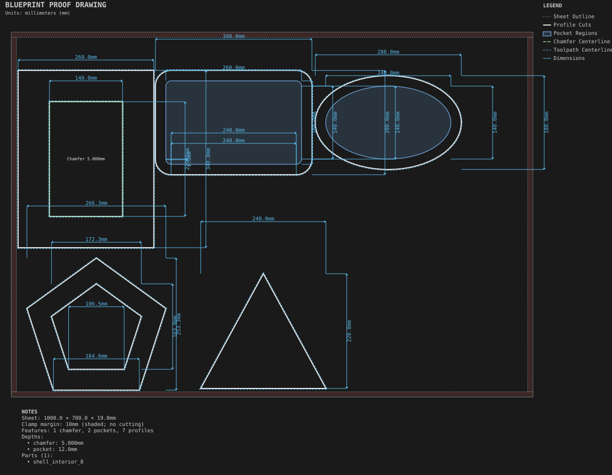

# Frames and trays

**Demonstrates:** Non-rectangular outlines, inside profiles, Subtract and Shell.

## What gets cut

A picture frame with a chamfered opening, a rounded serving tray, an oval tray, a pentagon frame, and a triangular trivet.

The pentagon's inside and outside profiles retain a 40mm frame. The
picture-frame chamfer cuts a 5 × 5mm bevel on the opening rim and leaves 55mm
of flat frame outside it. The V-bit tip follows the nominal opening edge.

Sheet 1000 × 700 × 19mm mdf.

- `pocket-9.53mm.nc`: pocket, 9.525mm tool, 2 operation(s), to 12mm
- `edge-12.70mm.nc`: edge, 12.7mm tool, 1 operation(s), to 5mm
- `profile-9.53mm.nc`: profile, 9.525mm tool, 7 operation(s), to 19.2mm

## Run

`python -m cli.mill --recipe docs/recipes/panels/frames_and_trays`

## Outputs

- `edge-12.70mm.nc`
- `frames_and_trays.svg`
- `machining_summary.json`
- `metrics.json`
- `pocket-9.53mm.nc`
- `profile-9.53mm.nc`
