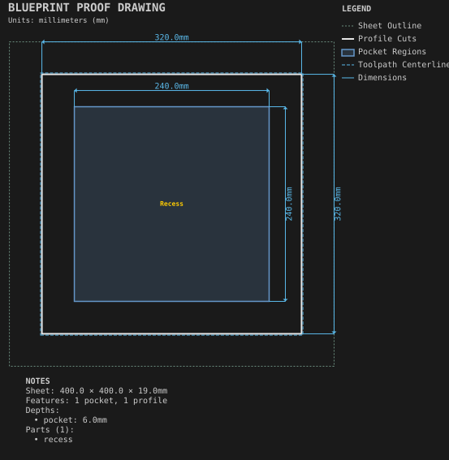
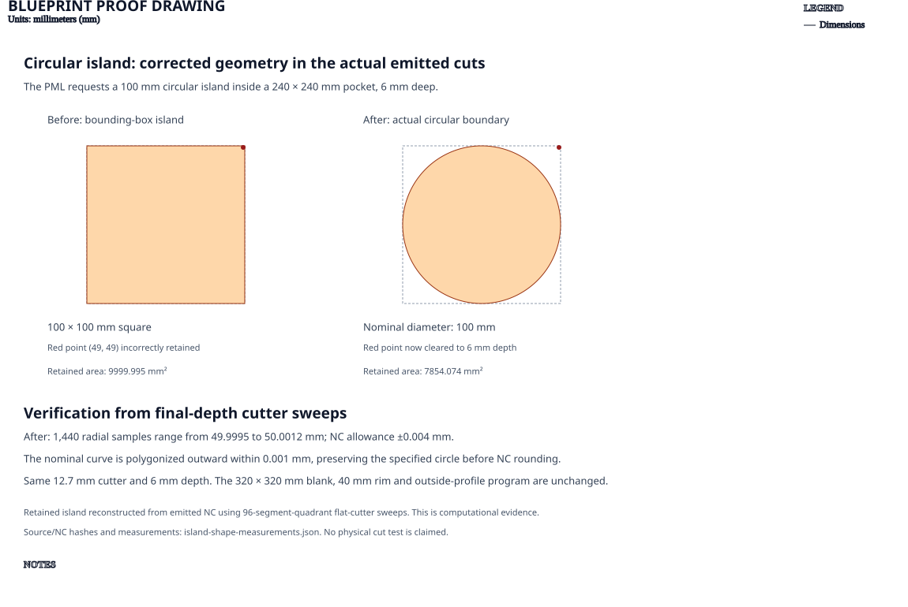

# Pocket with island

**Demonstrates:** A pocket that leaves an island of material standing.

## What gets cut

A 320 × 320 × 19mm panel with a 240 × 240mm pocket, 6mm deep, leaving a
Ø100mm circular island at full thickness and a 40mm outer rim. The pocket floor
remains 13mm thick.

## Island-shape proof

The earlier resolver incorrectly replaced the circle with its 100 × 100mm
bounding square. The shared fix preserves the island boundary through the
existing polygon-pocket path. The recipe's PML, tooling, depths and outside
profile remain unchanged.

[Measurements and source/NC hashes](island-shape-measurements.json) reconstruct
the retained island from the emitted final-depth 12.7mm cutter sweeps. Across
1,440 radial samples, its radius is 49.9995–50.0012mm, within the 0.004mm NC
rounding allowance. Points near the old square's corners are now cleared.
The nominal curved exclusion is conservative within 0.001mm before NC rounding.
This is computational evidence, not a physical cut trial. The corrected circular
result remains for the owner's intent review.

Sheet 400 × 400 × 19mm mdf.

- `pocket-12.70mm.nc`: pocket, 12.7mm tool, 1 feature(s), to 6mm
- `profile-3.17mm.nc`: profile, 3.175mm tool, 1 feature(s), to 19.2mm

## Run

`python -m cli.mill --recipe docs/recipes/panels/pocket_with_island`

## Outputs

- `machining_summary.json`
- `metrics.json`
- `pocket-12.70mm.nc`
- `pocket_with_island.svg`
- `profile-3.17mm.nc`
