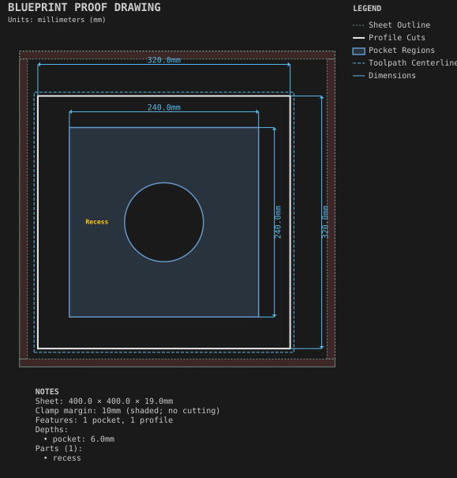

# Pocket with island

**Demonstrates:** A pocket that leaves an island of material standing.

## What gets cut

A 320 × 320 × 19mm panel with a 240 × 240mm pocket, 6mm deep, leaving a
Ø100mm circular island at full thickness and a 40mm outer rim. The pocket floor
remains 13mm thick.

Sheet 400 × 400 × 19mm mdf.

- `pocket-9.53mm.nc`: pocket, 9.525mm tool, 1 operation(s), to 6mm
- `profile-9.53mm.nc`: profile, 9.525mm tool, 1 operation(s), to 19.2mm

## Run

`python -m cli.mill --recipe docs/recipes/panels/pocket_with_island`

## Outputs

- `machining_summary.json`
- `metrics.json`
- `pocket-9.53mm.nc`
- `pocket_with_island.svg`
- `profile-9.53mm.nc`
