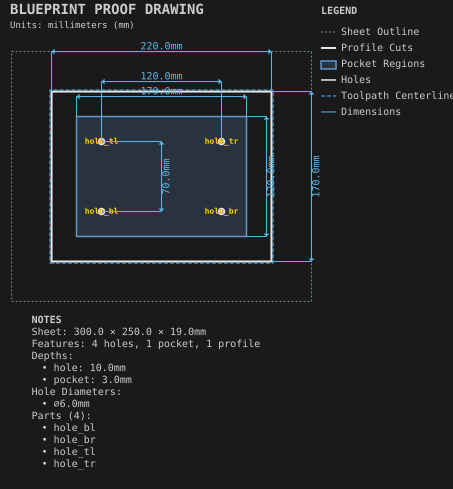
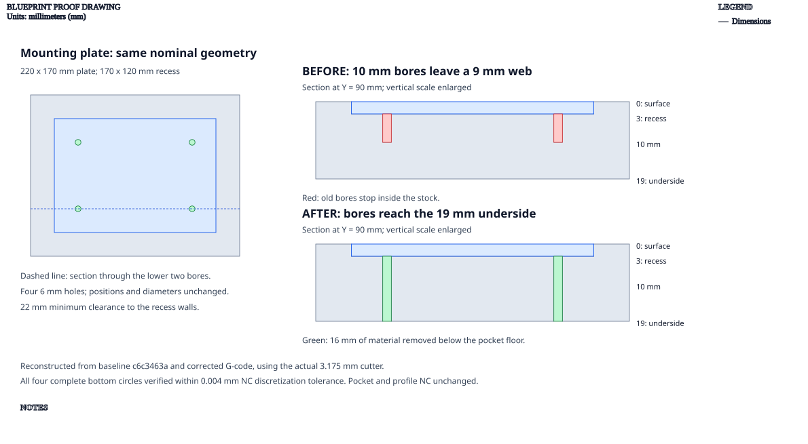

# Recessed mounting plate

**Demonstrates:** Holes drilled through the floor of a pocket.

## What gets cut

A plate with a 3mm recess and four 6mm through-holes, cut out with an outside profile. The bores reach 19mm below the original surface, removing the remaining 16mm below the recess floor.

The previous 10mm bores left a 9mm web. All four corrected bores complete their
bottom circles at 19mm depth with the same 6mm nominal diameter and positions.
The cutter-footprint check allows 0.004mm for NC discretization. The pocket and
outside-profile programs are unchanged.

Sheet 300 × 250 × 19mm mdf.

- `pocket-12.70mm.nc`: pocket, 12.7mm tool, 1 feature(s), to 3mm
- `bore-3.17mm.nc`: bore, 3.175mm tool, 4 feature(s), to 19mm
- `profile-3.17mm.nc`: profile, 3.175mm tool, 1 feature(s), to 19.2mm

## Run

`python -m cli.mill --recipe docs/recipes/panels/recessed_mounting_plate`

## Outputs

- `bore-3.17mm.nc`
- `machining_summary.json`
- `metrics.json`
- `pocket-12.70mm.nc`
- `profile-3.17mm.nc`
- `recessed_mounting_plate.svg`
