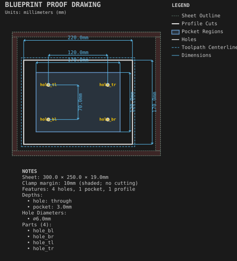

# Recessed mounting plate

**Demonstrates:** Holes drilled through the floor of a pocket.

## What gets cut

A plate with a 3mm recess and four 6mm through-holes, cut out with an outside profile. The bores reach 19mm below the original surface, removing the remaining 16mm below the recess floor.

Sheet 300 × 250 × 19mm mdf.

- `pocket-9.53mm.nc`: pocket, 9.525mm tool, 1 operation(s), to 3mm
- `bore-3.17mm.nc`: bore, 3.175mm tool, 4 operation(s), to 19mm
- `profile-9.53mm.nc`: profile, 9.525mm tool, 1 operation(s), to 19.2mm

## Run

`python -m cli.mill --recipe docs/recipes/panels/recessed_mounting_plate`

## Outputs

- `bore-3.17mm.nc`
- `machining_summary.json`
- `metrics.json`
- `pocket-9.53mm.nc`
- `profile-9.53mm.nc`
- `recessed_mounting_plate.svg`
