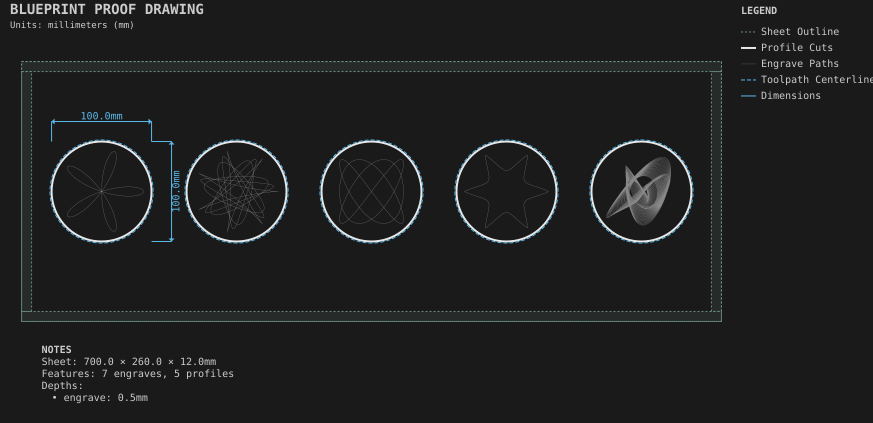
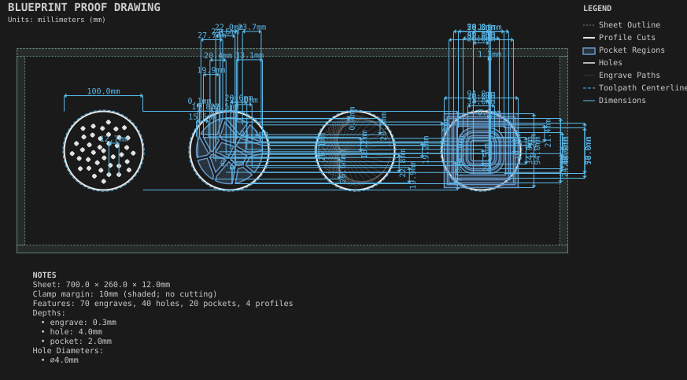
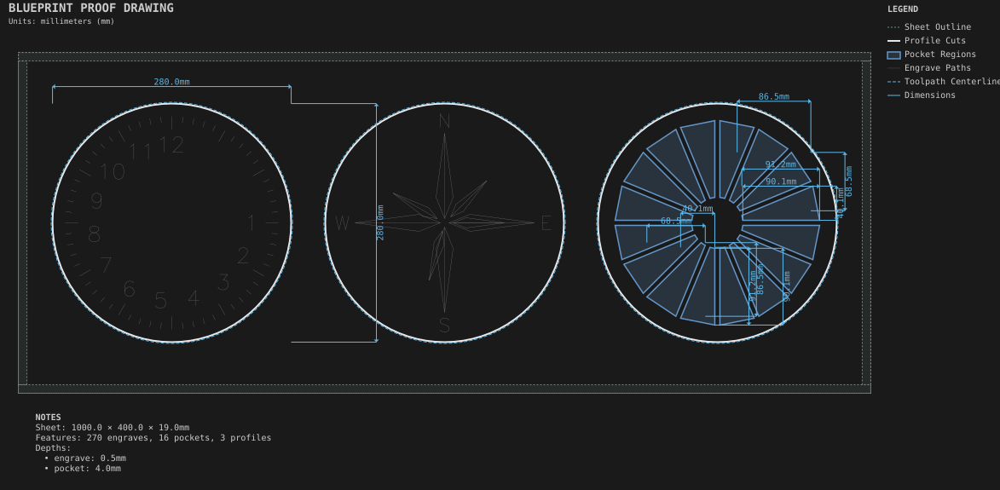
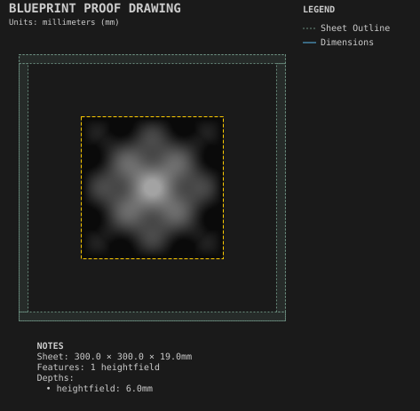

# Patterns

Generated art, cut as coasters and discs so each family sits beside its siblings.

Generated by `python -m cli.recipes --regen`. Do not edit by hand.

## [Curve coasters](curve_coasters/)

The curve families: rose, spirograph, Lissajous, superformula and harmonograph.

## [Pattern coasters](pattern_coasters/)

Phyllotaxis, Voronoi, string art and concentric ripples.

## [Radial patterns](radial_patterns/)

Ticks, labels, pockets and SVG motifs repeated around a center.

## [Relief carving](relief_carving/)

Heightfield relief roughed with flat tools and finished with a ball-nose.
