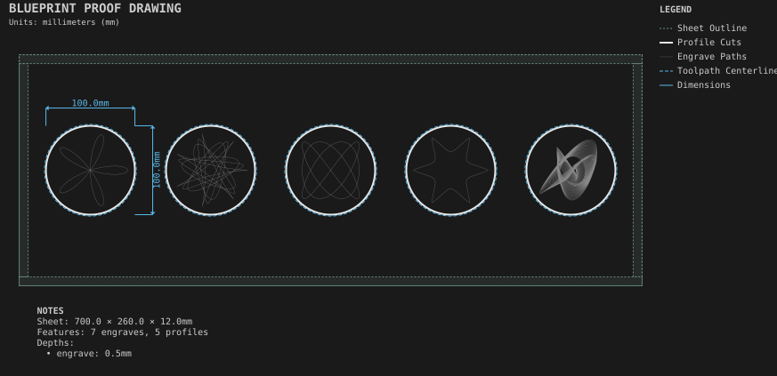

# Curve coasters

**Demonstrates:** The curve families: rose, spirograph, Lissajous, superformula and harmonograph.

## What gets cut

Five 100mm coasters, each engraved with one curve family: rose, spirograph, Lissajous, superformula, harmonograph.

Sheet 700 × 260 × 12mm mdf.

- `engrave-1.00mm.nc`: engrave, 1mm tool, 7 feature(s), to 0.5mm
- `profile-3.17mm.nc`: profile, 3.175mm tool, 5 feature(s), to 12.2mm

## Run

`python -m cli.mill --recipe docs/recipes/patterns/curve_coasters`

## Outputs

- `curve_coasters.svg`
- `engrave-1.00mm.nc`
- `machining_summary.json`
- `metrics.json`
- `profile-3.17mm.nc`
