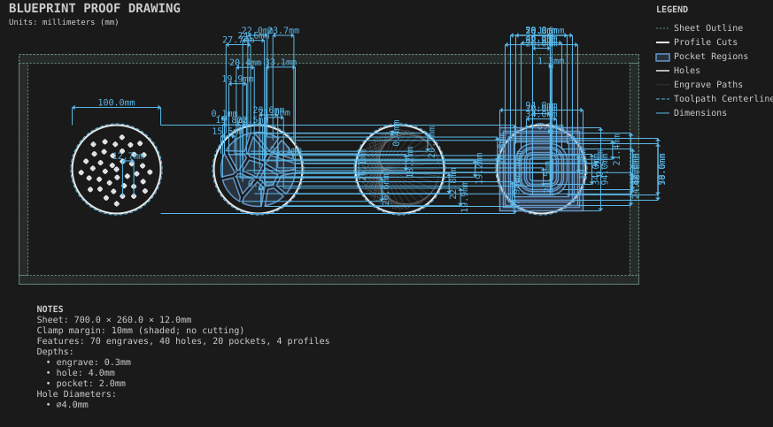

# Pattern coasters

**Demonstrates:** Phyllotaxis, Voronoi, string art and concentric ripples.

## What gets cut

Four coasters: phyllotaxis holes, Voronoi cells, string art, concentric ripples.

Sheet 700 × 260 × 12mm mdf.

- `pocket-9.53mm.nc`: pocket, 9.525mm tool, 3 feature(s), to 2mm
- `pocket-12.70mm.nc`: pocket, 12.7mm tool, 11 feature(s), to 2mm
- `pocket-3.17mm.nc`: pocket, 3.175mm tool, 6 feature(s), to 2mm
- `bore-3.17mm.nc`: bore, 3.175mm tool, 40 feature(s), to 4mm
- `engrave-1.00mm.nc`: engrave, 1mm tool, 70 feature(s), to 0.3mm
- `profile-3.17mm.nc`: profile, 3.175mm tool, 4 feature(s), to 12.2mm

## Run

`python -m cli.mill --recipe docs/recipes/patterns/pattern_coasters`

## Outputs

- `bore-3.17mm.nc`
- `engrave-1.00mm.nc`
- `machining_summary.json`
- `metrics.json`
- `pattern_coasters.svg`
- `pocket-12.70mm.nc`
- `pocket-3.17mm.nc`
- `pocket-9.53mm.nc`
- `profile-3.17mm.nc`
