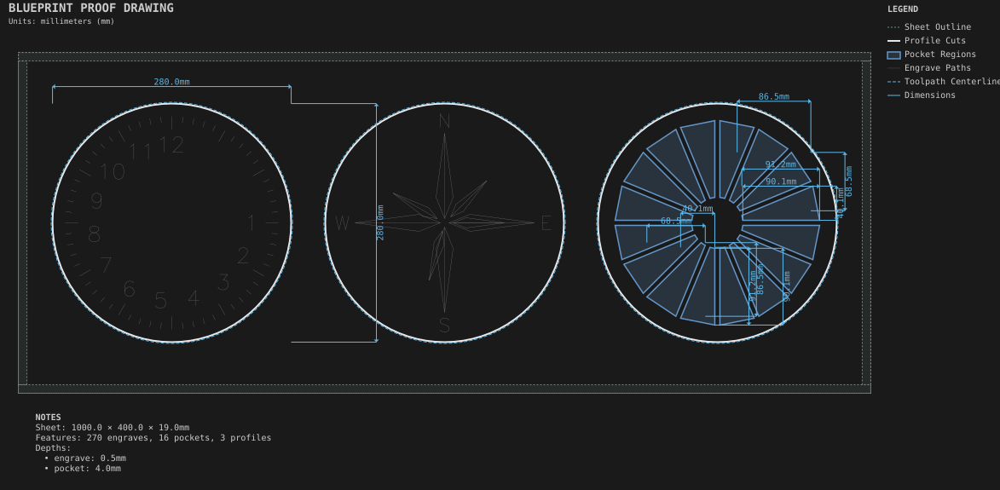
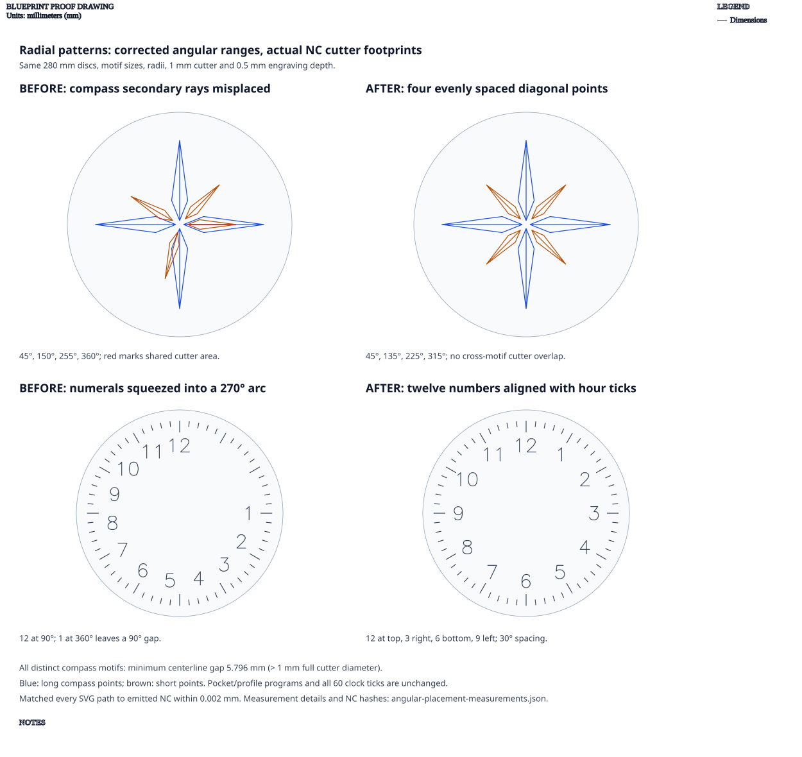

# Radial patterns

**Demonstrates:** Ticks, labels, pockets and SVG motifs repeated around a center.

## What gets cut

Three discs: a clock face with ticks and numerals, a compass rose, and a sunburst of pockets.

The clock numbers use a complete 90°–450° span, placing 12 at the top and
3, 6 and 9 at the right, bottom and left. The compass has four long points at
0°, 90°, 180° and 270°, and four shorter points at 45°, 135°, 225° and 315°.
Its cardinal labels use 90°–450° as well.

`end_angle` is an absolute endpoint. Leaving its 360° default with a 45° start
previously misplaced the short compass points at 45°, 150°, 255° and 360°,
causing four real engraving crossings. The clock's numerals were similarly
squeezed into a 270° arc. Explicit full-circle endpoints fix both without
changing motif sizes, radii, cutter selection or engraving depth.

The proof uses the actual 1mm cutter at 0.5mm depth. The closest distinct compass
motifs now have 5.796mm centerline separation, leaving 4.796mm between their
conservative full-diameter cutter footprints. All four reported pairs are
clear. [Measurements and NC hashes](angular-placement-measurements.json) record
the before/after cuts, matched within 0.002mm NC rounding tolerance.
All 60 clock ticks and the pocket/profile programs remain unchanged.

Sheet 1000 × 400 × 19mm mdf.

- `pocket-12.70mm.nc`: pocket, 12.7mm tool, 16 feature(s), to 4mm
- `engrave-1.00mm.nc`: engrave, 1mm tool, 270 feature(s), to 0.5mm
- `profile-3.17mm.nc`: profile, 3.175mm tool, 3 feature(s), to 19.2mm

## Run

`python -m cli.mill --recipe docs/recipes/patterns/radial_patterns`

## Outputs

- `engrave-1.00mm.nc`
- `machining_summary.json`
- `metrics.json`
- `pocket-12.70mm.nc`
- `profile-3.17mm.nc`
- `radial_patterns.svg`
