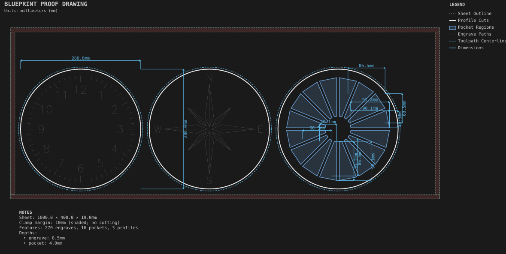

# Radial patterns

**Demonstrates:** Ticks, labels, pockets and SVG motifs repeated around a center.

## What gets cut

Three discs: a clock face with ticks and numerals, a compass rose, and a sunburst of pockets.

The clock numbers use a complete 90°–450° span, placing 12 at the top and
3, 6 and 9 at the right, bottom and left. The compass has four long points at
0°, 90°, 180° and 270°, and four shorter points at 45°, 135°, 225° and 315°.
Its cardinal labels use 90°–450° as well.

`end_angle` is an absolute endpoint. A full circle starting at 45° therefore
ends at 405°; a full circle starting at 90° ends at 450°.

Sheet 1000 × 400 × 19mm mdf.

- `pocket-9.53mm.nc`: pocket, 9.525mm tool, 16 operation(s), to 4mm
- `engrave-1.00mm.nc`: engrave, 1mm tool, 270 operation(s), to 0.5mm
- `profile-9.53mm.nc`: profile, 9.525mm tool, 3 operation(s), to 19.2mm

## Run

`python -m cli.mill --recipe docs/recipes/patterns/radial_patterns`

## Outputs

- `engrave-1.00mm.nc`
- `machining_summary.json`
- `metrics.json`
- `pocket-9.53mm.nc`
- `profile-9.53mm.nc`
- `radial_patterns.svg`
