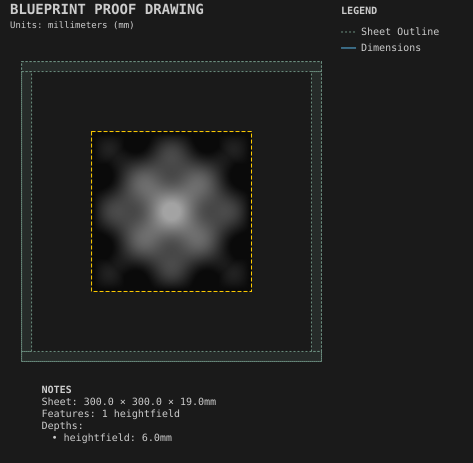

# Relief carving

**Demonstrates:** Heightfield relief roughed with flat tools and finished with a ball-nose.

## What gets cut

A heightfield relief roughed with two flat tools and finished with a ball-nose.

Sheet 300 × 300 × 19mm mdf.

- `heightfield-rough-6.35mm.nc`: heightfield-rough, 6.35mm tool, 1 feature(s), to 5.7mm
- `heightfield-rough-3.17mm.nc`: heightfield-rough, 3.175mm tool, 1 feature(s), to 5.7mm
- `heightfield-finish-3.19mm.nc`: heightfield-finish, 3.19mm tool, 1 feature(s), to 4.405mm

## Run

`python -m cli.mill --recipe docs/recipes/patterns/relief_carving`

## Outputs

- `heightfield-finish-3.19mm.nc`
- `heightfield-rough-3.17mm.nc`
- `heightfield-rough-6.35mm.nc`
- `machining_summary.json`
- `metrics.json`
- `relief_carving.svg`
