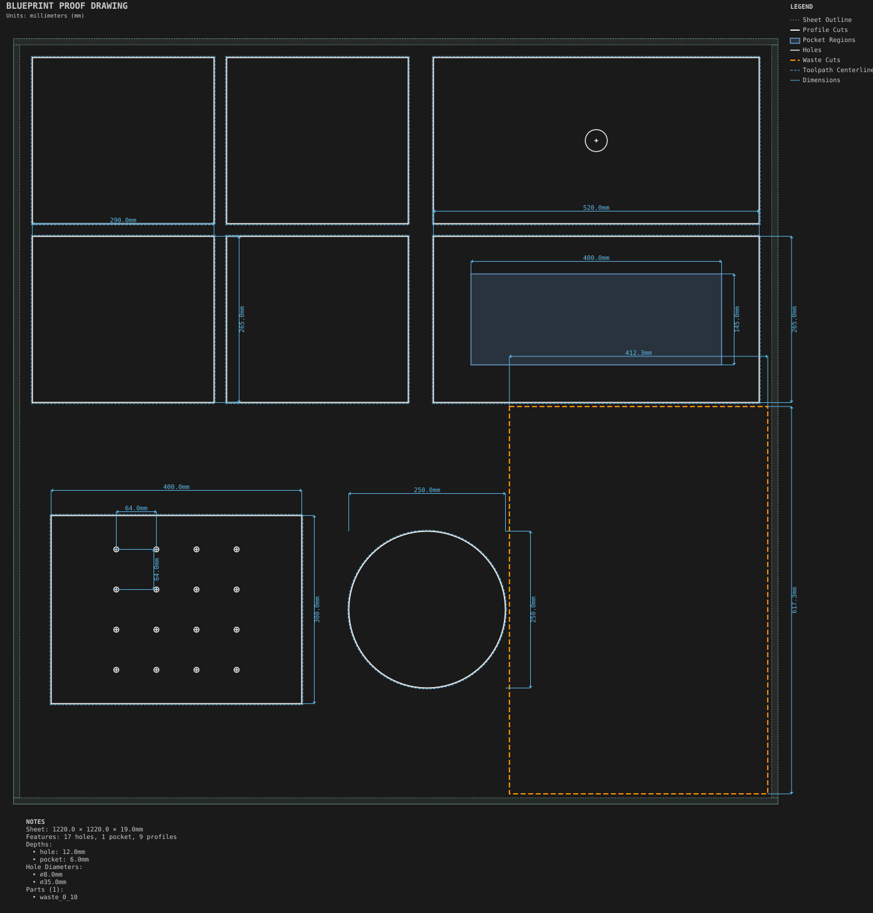

# Production

Whole-sheet jobs laid out for the machine.

Generated by `python -m cli.recipes --regen`. Do not edit by hand.

## [Nested cabinet job](nested_cabinet_job/)

Nesting a part list with MaxRects, including templated parts, shaped parts and a per-part holding override.

## [Production sheet](production_sheet/)

A whole-sheet job: tabs, onion skin, waste cuts, safe Z, per-tool G-code, feed overrides and a kerf override.
