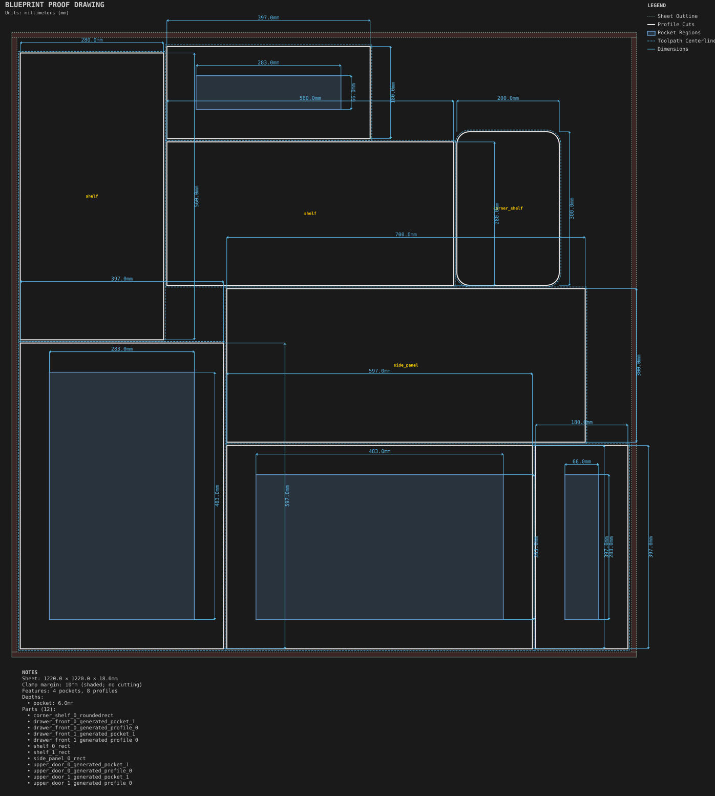
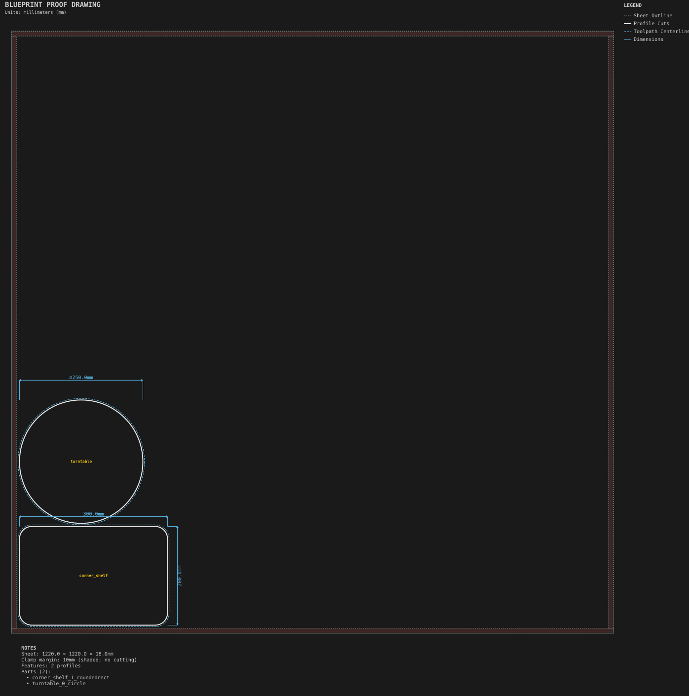

# Nested cabinet job

**Demonstrates:** Nesting a part list with MaxRects, including templated parts, shaped parts and a per-part holding override.

## What gets cut

Ten parts on two 1220 × 1220 × 18mm MDF sheets: two 397 × 597mm Shaker doors,
two 397 × 180mm Shaker drawer fronts, one 300 × 700mm side panel, two
560 × 280mm shelves, two 300 × 200mm rounded corner shelves and one Ø250mm
turntable. The doors have 57mm stiles, 70mm rails and a 6mm center recess;
the drawer fronts use the Shaker template defaults.

The job is `nested_cabinet_job.nest.yml`. Its 6.35mm kerf sets part spacing and
reserves outside-profile cutter clearance inside the 10mm sheet margin.
Both generated blueprints show that clamp no-cut zone. Part dimensions are
preserved; packing may rotate parts by 90°.

Plain and shaped parts use a 0.3mm onion skin followed by a separate release
program. The side panel overrides that default with four 10mm-wide, 3mm-high
tabs. As specified by nesting's holding rules, template parts use their own
profile features; the job's holding default does not add skin or tabs to them.

Sheet 1 contains eight parts, including all four templated fronts. Sheet 2
contains the remaining corner shelf and turntable. Overall utilization is
45.5%; the second sheet's 7.6% utilization is a known packing limitation.
This is a mixed nesting example, not a complete cabinet assembly.

## Machining programs

- `sheet_1.pocket-12.70mm.nc`: four template recesses, 12.7mm tool, to 6mm
- `sheet_1.profile-6.35mm.nc`: eight profiles with their respective holding settings
- `sheet_1.release-6.35mm.nc`: release the three onion-skinned parts on sheet 1
- `sheet_2.profile-6.35mm.nc`: two profiles leaving 0.3mm onion skin
- `sheet_2.release-6.35mm.nc`: release both parts on sheet 2

## Run

`python -m cli.mill --recipe docs/recipes/production/nested_cabinet_job`

This nests the part list and runs each sheet through the normal machining
pipeline. `python -m cli.recipes --regen` regenerates these outputs along with
all other recipes; `python -m cli.recipes` checks their contents and design errors.

## Outputs

- `nested_cabinet_job_sheet_1.svg`
- `nested_cabinet_job_sheet_2.svg`
- `sheet_1.pocket-12.70mm.nc`
- `sheet_1.profile-6.35mm.nc`
- `sheet_1.release-6.35mm.nc`
- `sheet_2.profile-6.35mm.nc`
- `sheet_2.release-6.35mm.nc`
- `machining_summary.json`
- `metrics.json`
- `manifest.json`
