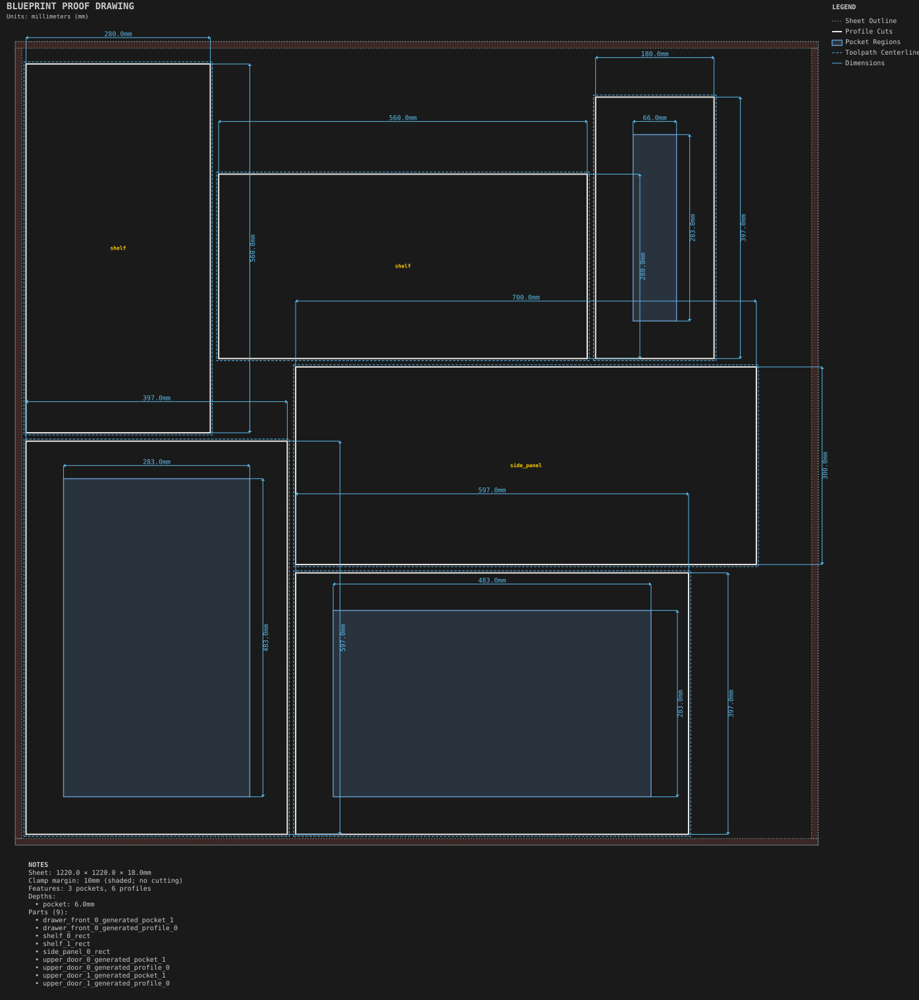
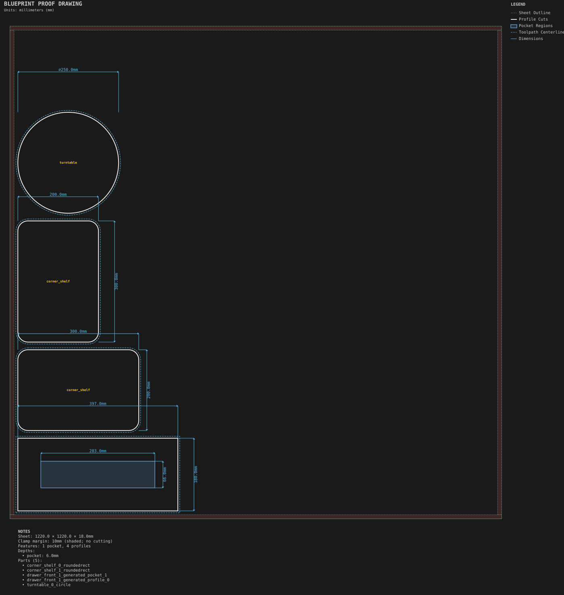

# Nested cabinet job

**Demonstrates:** Nesting a part list with MaxRects, including templated parts, shaped parts and a per-part holding override.

## What gets cut

Ten parts on two 1220 × 1220 × 18mm MDF sheets: two 397 × 597mm Shaker doors,
two 397 × 180mm Shaker drawer fronts, one 300 × 700mm side panel, two
560 × 280mm shelves, two 300 × 200mm rounded corner shelves and one Ø250mm
turntable. The doors have 57mm stiles, 70mm rails and a 6mm center recess;
the drawer fronts use the Shaker template defaults.

The job is `nested_cabinet_job.nest.yml`. Its 6.35mm kerf plus an explicit
6.35mm gap margin reserve disjoint kerfs around holding stock. The actual
selected cutter also reserves perimeter clearance inside the 10mm sheet margin.
Both generated blueprints show that clamp no-cut zone. Part dimensions are
preserved; packing may rotate parts by 90°.

Plain and shaped parts use a 0.3mm onion skin followed by a separate release
program. The side panel overrides that default with four 10mm-wide, 3mm-high
tabs. As specified by nesting's holding rules, template parts use their own
profile features; the job's holding default does not add skin or tabs to them.

Sheet 1 contains six parts: both upper doors, the side panel, both shelves
and one drawer front. Sheet 2 holds the other drawer front, both corner shelves
and the turntable. Overall utilization is 45.5%; sheet 2 uses 16.7%. The wider
spacing preserves holding stock while retaining the two-sheet layout.
This is a mixed nesting example, not a complete cabinet assembly.

## Machining programs

- `sheet_1.pocket-12.70mm.nc`: pocket, 12.7mm tool, 3 operation(s), to 6mm
- `sheet_1.profile-6.35mm.nc`: profile, 6.35mm tool, 6 contour(s), to 18.2mm
- `sheet_1.release-6.35mm.nc`: release, 6.35mm tool, 2 contour(s), to 18.2mm
- `sheet_2.profile-6.35mm.nc`: profile, 6.35mm tool, 4 contour(s), to 18.2mm
- `sheet_2.release-6.35mm.nc`: release, 6.35mm tool, 3 contour(s), to 18.2mm
- `sheet_2.pocket-12.70mm.nc`: pocket, 12.7mm tool, 1 operation(s), to 6mm

## Run

`python -m cli.mill --recipe docs/recipes/production/nested_cabinet_job`

This nests the part list and runs each sheet through the normal machining
pipeline. `python -m cli.recipes --regen` regenerates these outputs along with
all other recipes; `python -m cli.recipes` checks their contents and design errors.

## Outputs

- `machining_summary.json`
- `manifest.json`
- `metrics.json`
- `nested_cabinet_job_sheet_1.svg`
- `nested_cabinet_job_sheet_2.svg`
- `sheet_1.pocket-12.70mm.nc`
- `sheet_1.profile-6.35mm.nc`
- `sheet_1.release-6.35mm.nc`
- `sheet_2.pocket-12.70mm.nc`
- `sheet_2.profile-6.35mm.nc`
- `sheet_2.release-6.35mm.nc`
