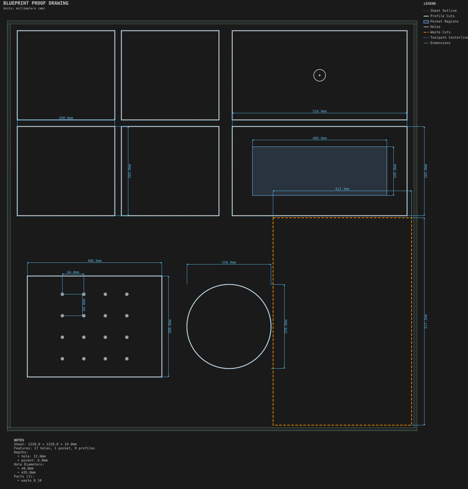

# Production sheet

**Demonstrates:** A whole-sheet job: tabs, onion skin, rough/finish allowances, waste cuts, safe Z, per-tool G-code, feed overrides and a kerf override.

## What gets cut

A full sheet of mixed parts held with tabs and onion skin, offcuts cut into usable blanks, a raised safe Z to clear clamps, and normal operations grouped per tool. Shelves combine allowances with tabs; the side panel combines allowances with onion skin. Roughing preserves a bottom web, then the final contours are finished before onion-skin release.

Sheet 1220 × 1220 × 19mm mdf.

- `12.70mm.nc`: pocket, 12.7mm tool, 1 feature(s), to 6mm
- `25.40mm.nc`: bore, 25.4mm tool, 1 feature(s), to 12mm
- `3.17mm-downcut.nc`: bore, 3.175mm tool, 16 feature(s), to 12mm
- `3.17mm-upcut.nc`: profiles and allowance finishing, 3.175mm tool, to 19.2mm
- `release-3.17mm.nc`: removes the three onion skins last, to 19.2mm

## Run

`python -m cli.mill --recipe docs/recipes/production/production_sheet`

Run the machining programs in the order listed above, with `release-3.17mm.nc`
last. The other parts retain their requested tabs. Release remains a separate
program even in per-tool mode.

## Outputs

- `12.70mm.nc`
- `25.40mm.nc`
- `3.17mm-downcut.nc`
- `3.17mm-upcut.nc`
- `machining_summary.json`
- `metrics.json`
- `production_sheet.svg`
- `release-3.17mm.nc`
