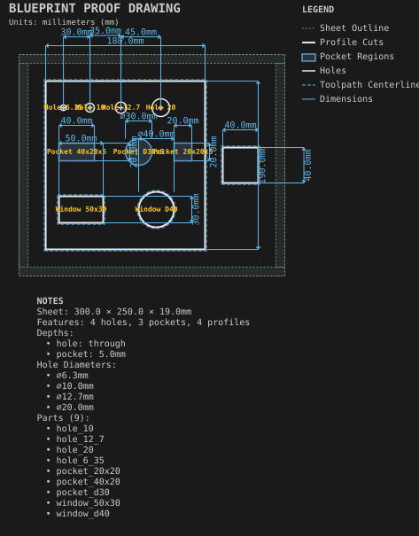
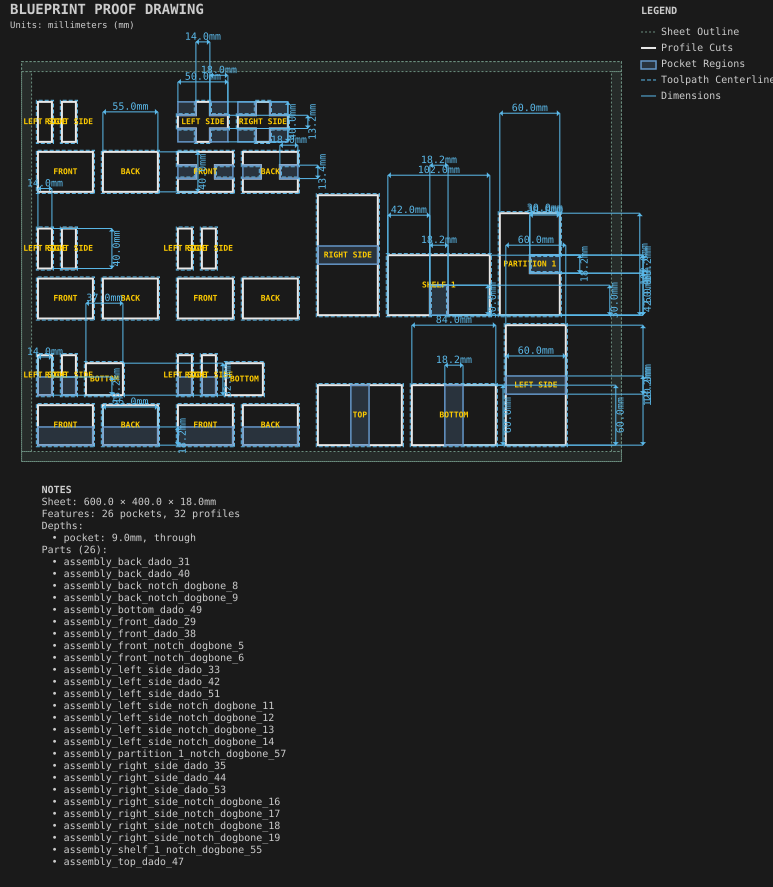
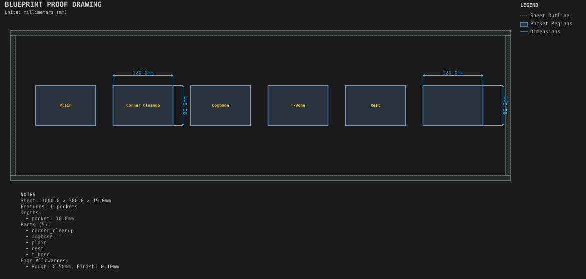
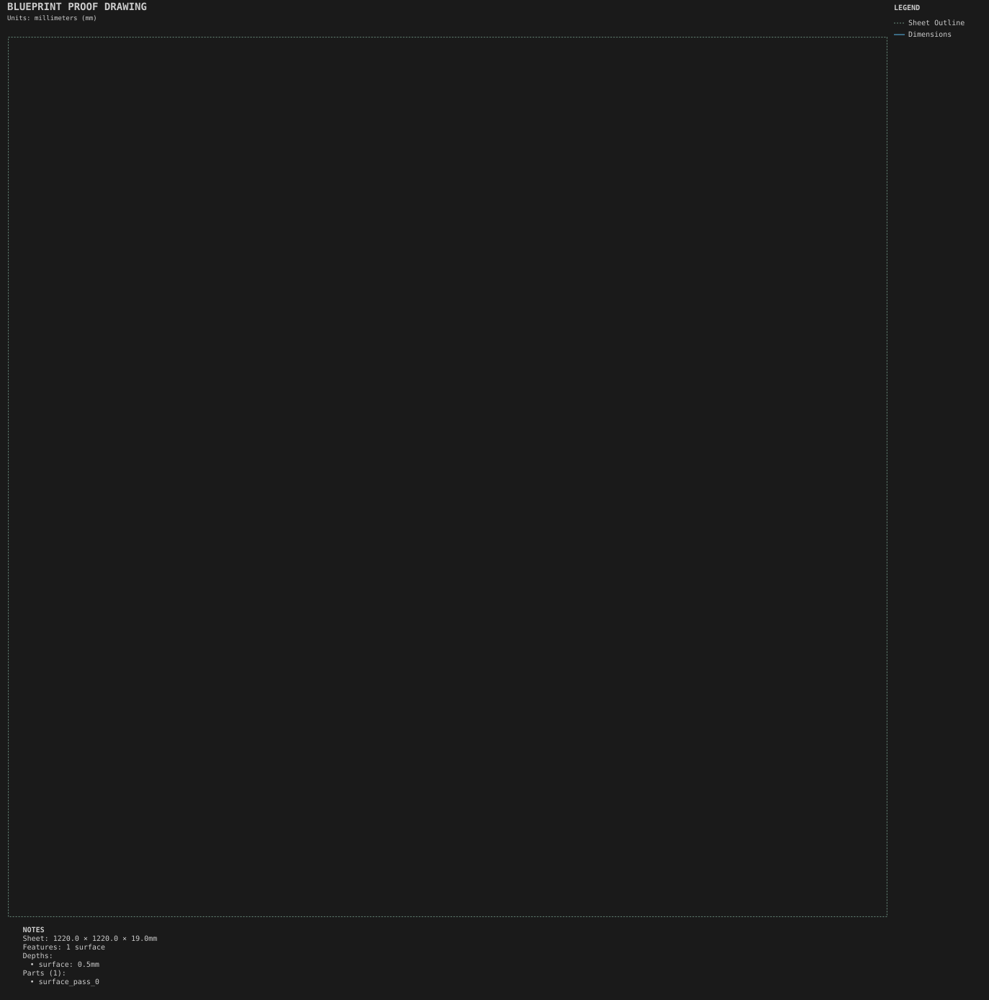

# Shop

Test pieces and machine upkeep: cut these to check the machine, the tools, and the fit before a real job.

Generated by `python -m cli.recipes --regen`. Do not edit by hand.

## [Calibration coupon](calibration_coupon/)

Holes, pockets and profiles at known sizes for checking the machine.

## [Joinery test coupons](joinery_test_coupons/)

Every joinery type as a small fit coupon.

## [Pocket corner test](pocket_corner_test/)

Pocket finishing options side by side: corner cleanup, dogbone, T-bone, rest pocketing and allowances.

## [Spoilboard surfacing](spoilboard_surfacing/)

Full-sheet facing with cooling retracts.
