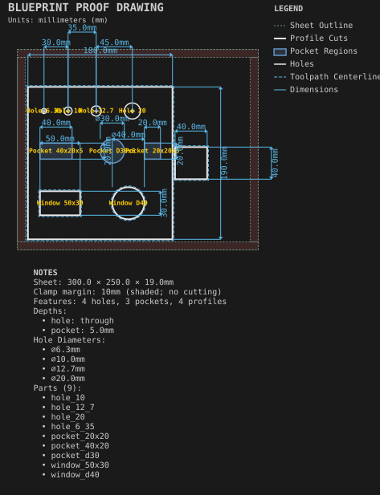

# Calibration coupon

**Demonstrates:** Holes, pockets and profiles at known sizes for checking the machine.

## What gets cut

A coupon of holes, pockets, and inside and outside profiles at known sizes, measured with calipers to check tool diameter and machine scale.

The rectangular and circular windows are inside profiles, separate from the
coupon's outside profile. Their nearest retained walls are 15mm and 25mm.

Inside cuts remove material toward the windows; the outside cut removes
material away from the coupon.

Sheet 300 × 250 × 19mm mdf.

- `pocket-9.53mm.nc`: pocket, 9.525mm tool, 3 operation(s), to 5mm
- `drill-6.35mm.nc`: drill, 6.35mm tool, 1 operation(s), to 19mm
- `bore-9.53mm.nc`: bore, 9.525mm tool, 1 operation(s), to 19mm
- `drill-12.70mm.nc`: drill, 12.7mm tool, 1 operation(s), to 19mm
- `bore-12.70mm.nc`: bore, 12.7mm tool, 1 operation(s), to 19mm
- `profile-9.53mm.nc`: profile, 9.525mm tool, 4 operation(s), to 19.2mm

## Run

`python -m cli.mill --recipe docs/recipes/shop/calibration_coupon`

## Outputs

- `bore-12.70mm.nc`
- `bore-9.53mm.nc`
- `calibration_coupon.svg`
- `drill-12.70mm.nc`
- `drill-6.35mm.nc`
- `machining_summary.json`
- `metrics.json`
- `pocket-9.53mm.nc`
- `profile-9.53mm.nc`
