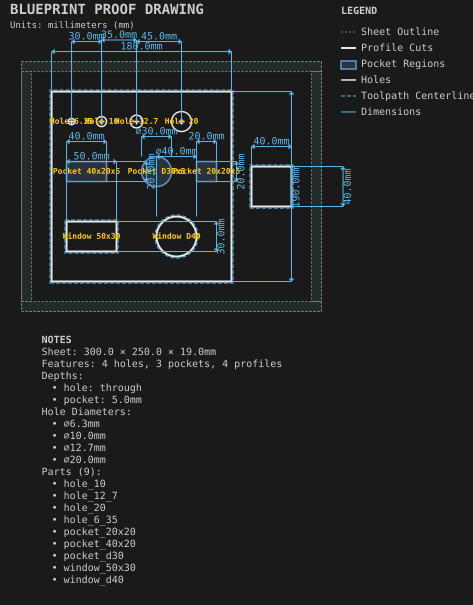
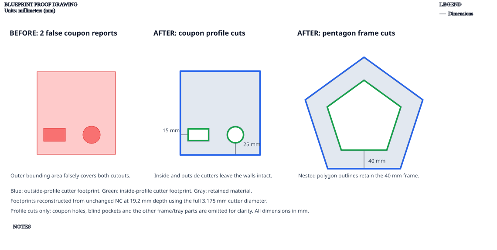

# Calibration coupon

**Demonstrates:** Holes, pockets and profiles at known sizes for checking the machine.

## What gets cut

A coupon of holes, pockets, and inside and outside profiles at known sizes, measured with calipers to check tool diameter and machine scale.

The rectangular and circular windows are inside profiles, separate from the
coupon's outside profile. Their nearest retained walls are 15mm and 25mm.

The proof reconstructs the unchanged profile G-code using the full 3.175mm
cutter diameter. Inside cuts remove material toward the windows; the outside
cut removes material away from the coupon. Their cutter footprints do not
intersect.

Sheet 300 × 250 × 19mm mdf.

- `pocket-12.70mm.nc`: pocket, 12.7mm tool, 3 feature(s), to 5mm
- `bore-3.17mm.nc`: bore, 3.175mm tool, 1 feature(s), to 19mm
- `pocket-3.17mm.nc`: pocket, 3.175mm tool, 3 feature(s), to 19mm
- `profile-3.17mm.nc`: profile, 3.175mm tool, 4 feature(s), to 19.2mm

## Run

`python -m cli.mill --recipe docs/recipes/shop/calibration_coupon`

## Outputs

- `bore-3.17mm.nc`
- `calibration_coupon.svg`
- `machining_summary.json`
- `metrics.json`
- `pocket-12.70mm.nc`
- `pocket-3.17mm.nc`
- `profile-3.17mm.nc`
