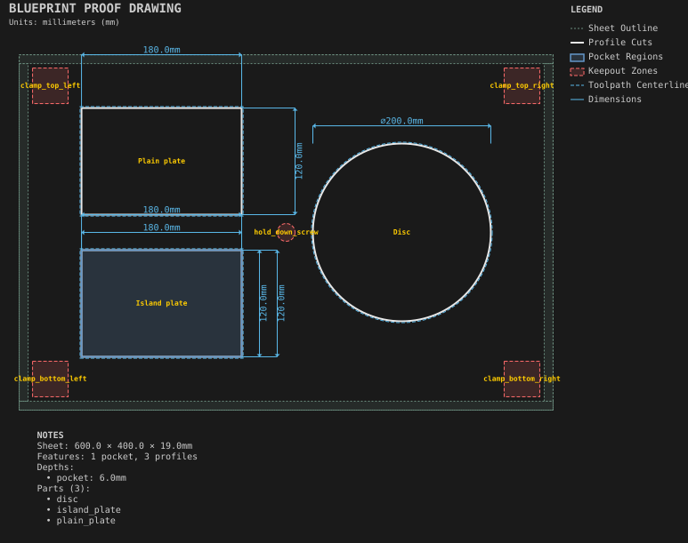

# Clamp keepouts

**Demonstrates:** Fixture keepouts checked against every front-setup cutting segment, separately from a pocket's preserved island.

## What gets cut

A 600 × 400 × 19mm MDF sheet with a 10mm margin holds two 180 × 120mm plates and one Ø200mm disc. Each outline cuts through with four 3mm-high tabs. The first plate has a 6mm pocket around a 60 × 40mm island left at full thickness.

Four 40 × 40mm clamp zones and one Ø20mm screw zone are fixture geometry. The verifier conservatively uses each zone's bounding box, expanded by the selected tool radius. Every cut clears those zones. Fixture zones apply to the front setup; a back setup needs its own fixturing.

A cutting violation blocks all G-code for that setup. A rapid crossing instead produces a warning naming the zone and safe Z: confirm fixture height is below the stated 6mm safe Z. The system does not model clamp height.

The pocket's island is preserved in machining. Blueprint pocket fills do not yet show that preserved region correctly; that rendering defect is tracked in #222.

## Run

`python -m cli.mill --recipe docs/recipes/shop/clamp_keepouts`

## Outputs

The blueprint, G-code, machining summary, and validation metrics are written to `output/`.
